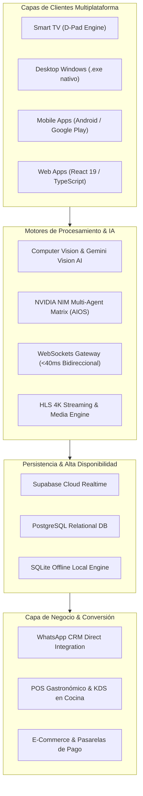
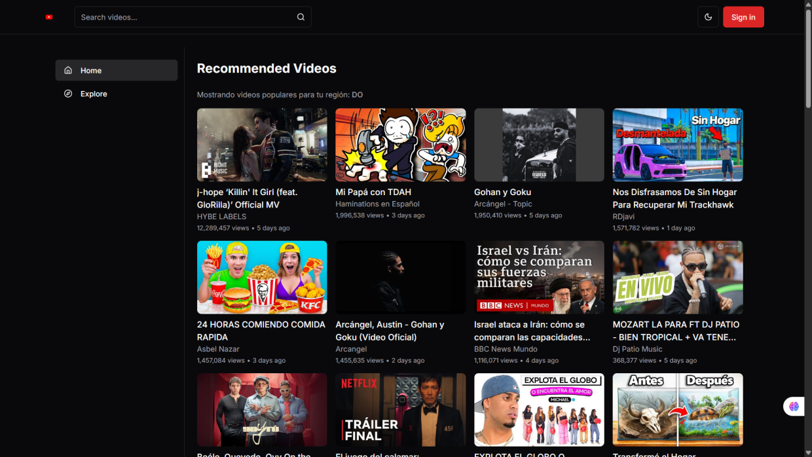
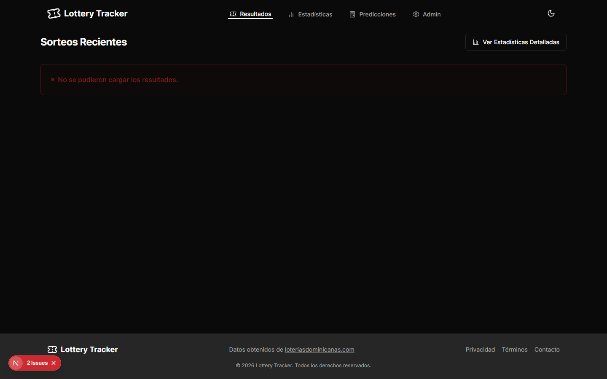

# BVX LAB
### *Create. Develop. Grow. // Software Architecture & AI Engineering*
**Punta Cana, República Dominicana · Operaciones Globales**

 [_261--6367-25D366?style=for-the-badge&logo=whatsapp&logoColor=white)](https://wa.me/18492616367)   

---

## 🌟 Acerca de BVX LAB

**BVX LAB** es una firma de ingeniería de software, arquitectura en la nube e inteligencia artificial con sede en Punta Cana, República Dominicana. Construimos sistemas de misión crítica, aplicaciones móviles y de escritorio multiplataforma (Flutter, Windows .exe, Smart TV, Web), ecosistemas de IA con Computer Vision, y soluciones empresariales llave en mano con embudos de alta conversión.

> [!IMPORTANT]
> **Aviso de Portafolio:** Este repositorio contiene exclusivamente la **documentación técnica, diagramas de arquitectura, métricas, evidencias visuales y especificaciones** de nuestros 15 proyectos desarrollados. Todo el código fuente de los clientes se encuentra debidamente protegido y respaldado bajo acuerdos de confidencialidad y propiedad intelectual.

## 🏛️ Diagrama Global de la Arquitectura BVX LAB

El siguiente diagrama representa el ecosistema de capacidades y soluciones arquitectónicas que diseñamos y operamos:

---

## 📂 Índice General de Proyectos

| # | Proyecto | Categoría | Tiempo de Desarrollo | Stack Principal | URL / Acceso | Documentación |
| :-: | :--- | :--- | :-: | :--- | :--- | :-: |
| **01** | **CinemaDB / CineMás TV** | Streaming & Multiplataforma | `6 semanas` | Flutter Native, Smart TV D-Pad Engine, Windows .exe (Desktop) | [cinemadb.club](https://cinemadb.club) | [Ver Caso Completo ➔](projects/01-cinemadb.md) |
| **02** | **Caribe Glass Windows Solution** | Solución Empresarial B2B / B2C | `2 semanas` | React 19, TypeScript, Tailwind CSS v4 | [caribeglass.com](https://caribeglass.com/) | [Ver Caso Completo ➔](projects/02-caribeglass.md) |
| **03** | **OmniPlay Video Social** | Red Social & Video Streaming | `4 semanas` | React, TypeScript, Node.js | *Privado* | [Ver Caso Completo ➔](projects/03-omniplay.md) |
| **04** | **EDHEX Graduaciones** | Fintech & Gestión Académica | `3 semanas` | React, Node.js / Express, QR Cryptography Engine | *Privado* | [Ver Caso Completo ➔](projects/04-edhex.md) |
| **05** | **YouTube Frontend Core** | Arquitectura Web Multimedia | `2 semanas` | React, TypeScript, YouTube Data API v3 | *Privado* | [Ver Caso Completo ➔](projects/05-youtube-clone.md) |
| **06** | **Bacano Roleplay FiveM Hub** | Gaming & Comunidad Virtual | `2 semanas` | React, Node.js, Discord OAuth2 API | *Privado* | [Ver Caso Completo ➔](projects/06-bacano-roleplay.md) |
| **07** | **Freska POS & Restaurant Orders** | E-Commerce & GastroTech POS | `3 semanas` | React, TypeScript, Tailwind CSS | *Privado* | [Ver Caso Completo ➔](projects/07-orderly-eats-freska.md) |
| **08** | **Look Store E-Commerce** | E-Commerce & Retail de Moda | `2 semanas` | Next.js / React, Tailwind CSS, Supabase Database | *Privado* | [Ver Caso Completo ➔](projects/08-look-store.md) |
| **09** | **AIOS Kernel // NVIDIA NIM & Supabase** | Inteligencia Artificial & Sistemas Autónomos | `5 semanas` | Python, NVIDIA NIM LLM APIs, Supabase Cloud / PostgreSQL | [Repositorio GitHub Oficial](https://github.com/Wwb-Daniel/aios-agent-portfolio) | [Ver Caso Completo ➔](projects/09-aios-agent-portfolio.md) |
| **10** | **S1 Control Pro // Google Play Store** | Seguridad Corporativa, Móvil & Computer Vision | `8 semanas` | Flutter Native Mobile, Google Play Verified Production, Gemini Vision AI / OpenCV | [Descargar en Google Play Store](https://play.google.com/store/apps/details?id=com.smartsolutions.s1pro) | [Ver Caso Completo ➔](projects/10-s1-control-pro.md) |
| **11** | **Washington Martínez Constructora** | Real Estate & Construcción de Lujo | `3 semanas` | React 19, TypeScript, Tailwind CSS | [constructorawashington.com](http://constructorawashington.com) | [Ver Caso Completo ➔](projects/11-washington-martinez.md) |
| **12** | **Touring One SRL // Turismo VIP** | Turismo, Hotelería & Reservas | `4 semanas` | React, TypeScript, Tailwind CSS | *Privado* | [Ver Caso Completo ➔](projects/12-touring-one.md) |
| **13** | **Spotify Core Audio Player** | Streaming de Audio & Multimedia | `2 semanas` | React, TypeScript, Web Audio API | *Privado* | [Ver Caso Completo ➔](projects/13-spotify-clone.md) |
| **14** | **Whisp // Cifrado & WebSockets <40ms** | Telecomunicaciones & Criptografía | `6 semanas` | Flutter Native, WebSockets Sub-40ms Gateway, Supabase Realtime Cloud | [Repositorio GitHub Oficial](https://github.com/Wwb-Daniel/Whisp) | [Ver Caso Completo ➔](projects/14-whisp-messenger.md) |
| **15** | **Lottery Analytics & Trends** | Data Analytics & Predicciones | `3 semanas` | React, TypeScript, Chart.js / Recharts | *Privado* | [Ver Caso Completo ➔](projects/15-lottery-tracker.md) |

---

## 🚀 Catálogo Detallado de Proyectos

### 01. CinemaDB (CineMás TV) - Ecosistema de Streaming Multiplataforma

- ⏱️ **Tiempo de Desarrollo:** `6 semanas`
- 🏷️ **Categoría:** Streaming & Multiplataforma
- 🌐 **URL en Vivo:** [https://cinemadb.club](https://cinemadb.club)
- 🛠️ **Stack Tecnológico:** Flutter Native · Smart TV D-Pad Engine · Windows .exe (Desktop) · PostgreSQL / Supabase Realtime · HLS 4K Video Player · Node.js / Express · REST API
- 📄 **Documentación Completa:** [Leer ficha técnica y diagrama en projects/01-cinemadb.md](projects/01-cinemadb.md)

### 02. Caribe Glass - Plataforma Corporativa & Catálogo Arquitectónico de Cristal

- ⏱️ **Tiempo de Desarrollo:** `2 semanas`
- 🏷️ **Categoría:** Solución Empresarial B2B / B2C
- 🌐 **URL en Vivo:** [https://caribeglass.com/](https://caribeglass.com/)
- 🛠️ **Stack Tecnológico:** React 19 · TypeScript · Tailwind CSS v4 · Vite · Lucide Icons · WhatsApp Business CRM API · Netlify Edge CDN
- 📄 **Documentación Completa:** [Leer ficha técnica y diagrama en projects/02-caribeglass.md](projects/02-caribeglass.md)

### 03. OmniPlay - Plataforma de Video Streaming & Red Social Multimedia

- ⏱️ **Tiempo de Desarrollo:** `4 semanas`
- 🏷️ **Categoría:** Red Social & Video Streaming
- 🛠️ **Stack Tecnológico:** React · TypeScript · Node.js · Socket.io Realtime · Tailwind CSS · PostgreSQL · FFmpeg Transcoding
- 📄 **Documentación Completa:** [Leer ficha técnica y diagrama en projects/03-omniplay.md](projects/03-omniplay.md)

### 04. EDHEX - Sistema de Gestión de Graduación & Entradas Digitales

- ⏱️ **Tiempo de Desarrollo:** `3 semanas`
- 🏷️ **Categoría:** Fintech & Gestión Académica
- 🛠️ **Stack Tecnológico:** React · Node.js / Express · QR Cryptography Engine · Tailwind CSS · PostgreSQL · Supabase Auth
- 📄 **Documentación Completa:** [Leer ficha técnica y diagrama en projects/04-edhex.md](projects/04-edhex.md)

### 05. YouTube Core Platform Clone - Arquitectura Frontend de Alto Rendimiento

- ⏱️ **Tiempo de Desarrollo:** `2 semanas`
- 🏷️ **Categoría:** Arquitectura Web Multimedia
- 🛠️ **Stack Tecnológico:** React · TypeScript · YouTube Data API v3 · Tailwind CSS · Axios · Lucide React
- 📄 **Documentación Completa:** [Leer ficha técnica y diagrama en projects/05-youtube-clone.md](projects/05-youtube-clone.md)

### 06. Bacano Roleplay - Portal Comunitario, Sincronización FiveM & OAuth2

- ⏱️ **Tiempo de Desarrollo:** `2 semanas`
- 🏷️ **Categoría:** Gaming & Comunidad Virtual
- 🛠️ **Stack Tecnológico:** React · Node.js · Discord OAuth2 API · FiveM Server JSON API · Tailwind CSS · Vite
- 📄 **Documentación Completa:** [Leer ficha técnica y diagrama en projects/06-bacano-roleplay.md](projects/06-bacano-roleplay.md)

### 07. Freska / Orderly Eats - Punto de Venta (POS) & Pedidos para Restaurantes

- ⏱️ **Tiempo de Desarrollo:** `3 semanas`
- 🏷️ **Categoría:** E-Commerce & GastroTech POS
- 🛠️ **Stack Tecnológico:** React · TypeScript · Tailwind CSS · Zustand State Management · Supabase Realtime · Thermal Printing Engine
- 📄 **Documentación Completa:** [Leer ficha técnica y diagrama en projects/07-orderly-eats-freska.md](projects/07-orderly-eats-freska.md)

### 08. Look Store - Tienda de Moda B2C & Catálogo Textil Digital

- ⏱️ **Tiempo de Desarrollo:** `2 semanas`
- 🏷️ **Categoría:** E-Commerce & Retail de Moda
- 🛠️ **Stack Tecnológico:** Next.js / React · Tailwind CSS · Supabase Database · Stripe / WhatsApp Checkout
- 📄 **Documentación Completa:** [Leer ficha técnica y diagrama en projects/08-look-store.md](projects/08-look-store.md)

### 09. AIOS - Autonomous Agent Kernel & Multi-Agent Execution Matrix

- ⏱️ **Tiempo de Desarrollo:** `5 semanas`
- 🏷️ **Categoría:** Inteligencia Artificial & Sistemas Autónomos
- 🌐 **URL en Vivo:** [https://github.com/Wwb-Daniel/aios-agent-portfolio](https://github.com/Wwb-Daniel/aios-agent-portfolio)
- 🛠️ **Stack Tecnológico:** Python · NVIDIA NIM LLM APIs · Supabase Cloud / PostgreSQL · WebSockets Stream · GitHub DevOps API · Docker
- 📄 **Documentación Completa:** [Leer ficha técnica y diagrama en projects/09-aios-agent-portfolio.md](projects/09-aios-agent-portfolio.md)

### 10. S1 Control Pro - Seguridad Física, Geofencing GPS & Computer Vision en Google Play

- ⏱️ **Tiempo de Desarrollo:** `8 semanas`
- 🏷️ **Categoría:** Seguridad Corporativa, Móvil & Computer Vision
- 🌐 **URL en Vivo:** [https://play.google.com/store/apps/details?id=com.smartsolutions.s1pro](https://play.google.com/store/apps/details?id=com.smartsolutions.s1pro)
- 🛠️ **Stack Tecnológico:** Flutter Native Mobile · Google Play Verified Production · Gemini Vision AI / OpenCV · SQLite Local Engine (100% Offline) · High-Precision GPS Geofencing · PDF Export Engine · Supabase Cloud Sync
- 📄 **Documentación Completa:** [Leer ficha técnica y diagrama en projects/10-s1-control-pro.md](projects/10-s1-control-pro.md)

### 11. Washington Martínez Constructora - Ecosistema Inmobiliario & Catálogo de Villas 3D

- ⏱️ **Tiempo de Desarrollo:** `3 semanas`
- 🏷️ **Categoría:** Real Estate & Construcción de Lujo
- 🌐 **URL en Vivo:** [http://constructorawashington.com](http://constructorawashington.com)
- 🛠️ **Stack Tecnológico:** React 19 · TypeScript · Tailwind CSS · Framer Motion Animations · WhatsApp Business Integration · High-Res 3D Architectural Renders
- 📄 **Documentación Completa:** [Leer ficha técnica y diagrama en projects/11-washington-martinez.md](projects/11-washington-martinez.md)

### 12. Touring One SRL - Portal Turístico, Gestión de Hoteles & Reservas VIP

- ⏱️ **Tiempo de Desarrollo:** `4 semanas`
- 🏷️ **Categoría:** Turismo, Hotelería & Reservas
- 🛠️ **Stack Tecnológico:** React · TypeScript · Tailwind CSS · Supabase Database · WhatsApp Booking Gateway · Dashboard Administrativo Multi-Módulo
- 📄 **Documentación Completa:** [Leer ficha técnica y diagrama en projects/12-touring-one.md](projects/12-touring-one.md)

### 13. Spotify Core Platform Clone - Motor de Audio & Streaming Interactivo

- ⏱️ **Tiempo de Desarrollo:** `2 semanas`
- 🏷️ **Categoría:** Streaming de Audio & Multimedia
- 🛠️ **Stack Tecnológico:** React · TypeScript · Web Audio API · Tailwind CSS · Zustand State Store · Node.js Audio Gateway
- 📄 **Documentación Completa:** [Leer ficha técnica y diagrama en projects/13-spotify-clone.md](projects/13-spotify-clone.md)

### 14. Whisp: Realtime Messenger - Mensajería Cifrada con WebSockets Sub-40ms

- ⏱️ **Tiempo de Desarrollo:** `6 semanas`
- 🏷️ **Categoría:** Telecomunicaciones & Criptografía
- 🌐 **URL en Vivo:** [https://github.com/Wwb-Daniel/Whisp](https://github.com/Wwb-Daniel/Whisp)
- 🛠️ **Stack Tecnológico:** Flutter Native · WebSockets Sub-40ms Gateway · Supabase Realtime Cloud · PostgreSQL Row-Level Security · Bcrypt Criptografía · Audio Waveform Streaming
- 📄 **Documentación Completa:** [Leer ficha técnica y diagrama en projects/14-whisp-messenger.md](projects/14-whisp-messenger.md)

### 15. Lottery Tracker & Analytics - Análisis de Probabilidades, Sorteos & Métricas

- ⏱️ **Tiempo de Desarrollo:** `3 semanas`
- 🏷️ **Categoría:** Data Analytics & Predicciones
- 🛠️ **Stack Tecnológico:** React · TypeScript · Chart.js / Recharts · Tailwind CSS · PostgreSQL Database · Statistical Prediction Engine
- 📄 **Documentación Completa:** [Leer ficha técnica y diagrama en projects/15-lottery-tracker.md](projects/15-lottery-tracker.md)

---

## 👥 Liderazgo & Fundadores

### 👨‍💻 **Víctor de Jesús** (*Líder SK / Wwb-Daniel*)
- **Rol:** Lead Software Architect & Systems Engineer
- **Especialidades:** Flutter Native (iOS, Android, Windows, Smart TV), React 19, Supabase Realtime, WebSockets <40ms, Computer Vision AI & Sistemas Multi-Agente.
- **Contacto:** [GitHub (+46 Repos)](https://github.com/Wwb-Daniel) · [LinkedIn](https://www.linkedin.com/in/victor-dev-291a843a0/) · [TikTok](https://www.tiktok.com/@lisersk) · Email: victordejesus131318@gmail.com

### 🎨 **Bismel de Jesús**
- **Rol:** Creative, Branding & Growth Director
- **Especialidades:** Dirección de Arte & UI/UX en Figma, Producción Audiovisual, Estrategia de Adquisición Digital & Conversión en Embudos WhatsApp CRM.
- **Contacto:** [Instagram BVX](https://www.instagram.com/bvxlaps/) · Email: bvxlaps@gmail.com

---

## 📞 Contacto & Contrataciones

### ¿Tienes una idea o proyecto que quieres llevar a producción?

[_261--6367-25D366?style=for-the-badge&logo=whatsapp&logoColor=white)](https://wa.me/18492616367?text=Hola%20BVX%20LAB,%20quiero%20cotizar%20un%20proyecto)  

**Ubicación:** Punta Cana, La Altagracia · República Dominicana  
**Email Oficial:** [bvxlaps@gmail.com](mailto:bvxlaps@gmail.com)  
**Instagram Oficial:** [@bvxlaps](https://www.instagram.com/bvxlaps/)  

*© 2026 BVX LAB. Todos los derechos reservados.*  

