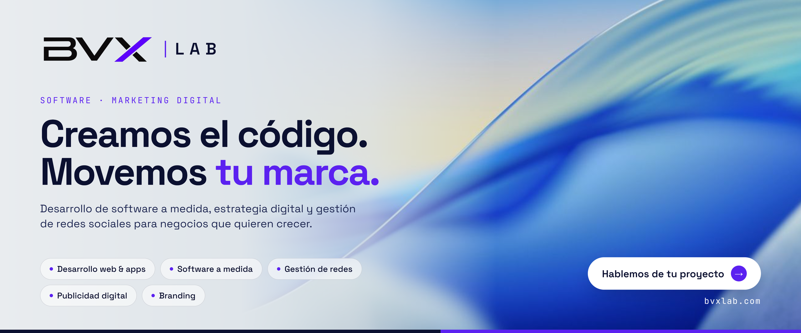
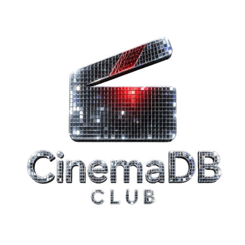
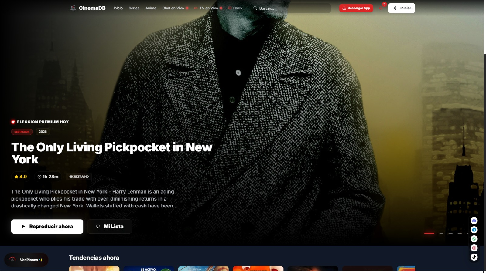
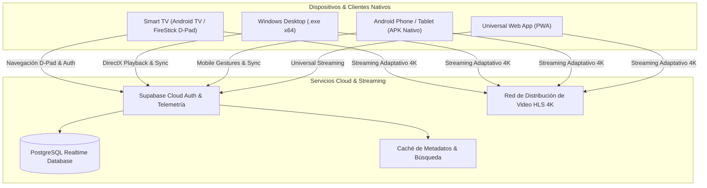
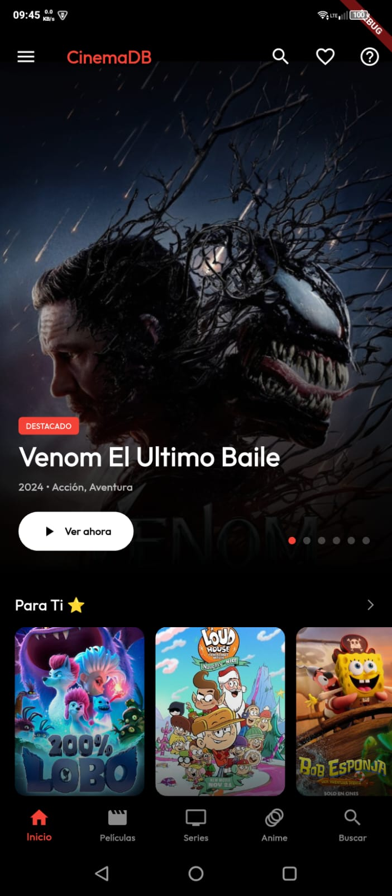
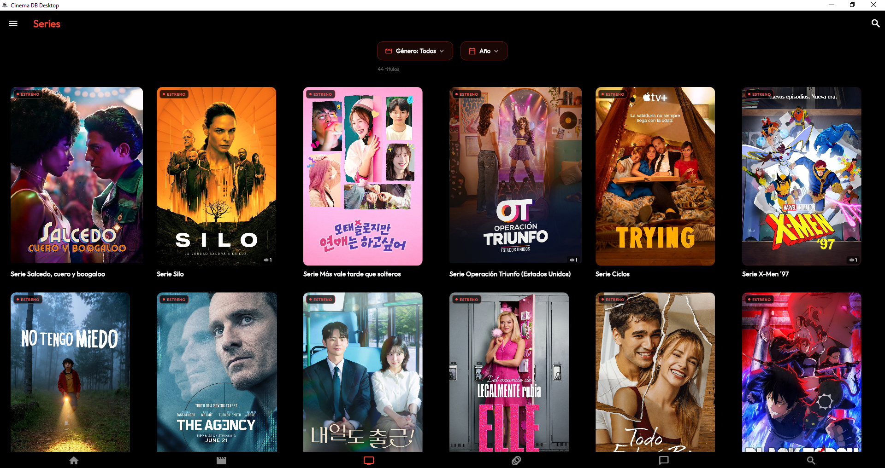
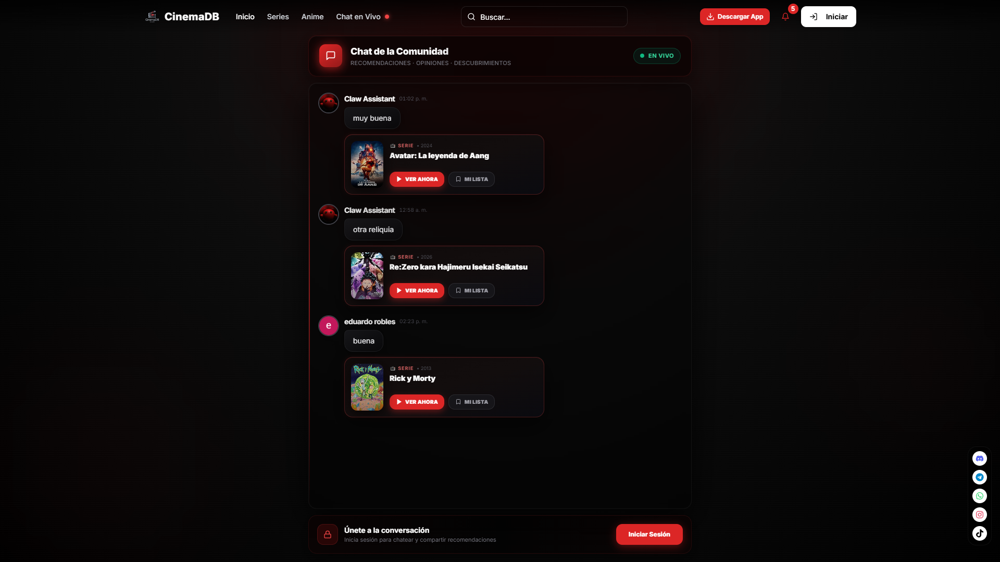
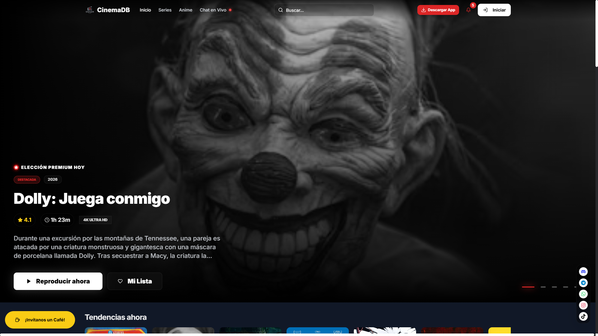
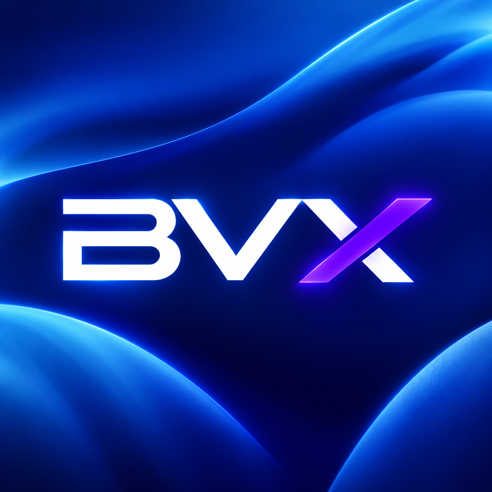

# CinemaDB (CineMás TV) - Ecosistema de Streaming Multiplataforma

  

# CinemaDB (CineMás TV)
### Plataforma de Streaming 4K Multiplataforma sin Costo
**🌐 [cinemadb.club](https://cinemadb.club)**

 
[_654--8277-25D366?style=for-the-badge&logo=whatsapp&logoColor=white)](https://wa.me/18296548277)

  

---

## 📌 Ficha Técnica del Proyecto

| Parámetro | Detalle Oficial |
| :--- | :--- |
| **Proyecto** | **CinemaDB / CineMás TV** |
| **Categoría** | Software, Streaming de Video & Ecosistema Multiplataforma |
| **Tiempo de Desarrollo** | ⏱️ **Casi 1 año (~12 meses de ingeniería integral multiplataforma)** |
| **URL Oficial en Producción** | 🌐 [https://cinemadb.club](https://cinemadb.club) |
| **Plataformas Soportadas** | Smart TV (Android TV/FireStick con control D-Pad), Windows (.exe x64), Android (APK Nativo), Web PWA |
| **Empresa Desarrolladora** | **BVX LAB** · Punta Cana, República Dominicana |
| **Arquitecto Principal** | Víctor de Jesús (*Líder SK / Wwb-Daniel*) |

---

## 🚀 Resumen Ejecutivo & Capacidades

**CinemaDB** es una solución integral de distribución y consumo de contenido bajo demanda (VOD) y televisión en directo (Live TV) de escala masiva. Desarrollada desde sus cimientos en **Flutter Native** para ofrecer soporte nativo a múltiples ecosistemas con una única base de código optimizada:

- **Smart TV Living Room OS:** Interfaz adaptada 100% para navegación con **control remoto por cruceta (D-Pad)**, con selección visual de botones, foco dinámico y transiciones suaves a 60 FPS.
- **Windows Desktop Nativo (.exe):** Versión x64 compilada para computadoras de escritorio, con aceleración por hardware DirectX/Vulkan y reproductor flotante PIP.
- **Android APK Nativo:** Experiencia móvil optimizada con soporte gestual para brillo y volumen, descargas para reproducción sin conexión y caché inteligente.
- **Universal Web Platform:** Aplicación web ultra liviana con renderizado reactivo y carga en menos de 1 segundo.

---

## 📊 Métricas & Desempeño en Producción

| Indicador | Registro de Producción |
| :--- | :--- |
| **Dispositivos Online Activos** | `+3,425 Dispositivos Conectados en Tiempo Real` |
| **Descargas Verificadas de APK** | `+2,936 Descargas Directas` |
| **Catálogo Multimedia Indexado** | `+8,100 Episodios, Películas y Documentales` |
| **Resolución & Bitrate** | `HLS Adaptativo hasta 4K 60fps (1080p, 720p, 480p)` |
| **Tiempo de Arranque del Stream** | `< 300 ms de buffering inicial` |

---

## 📐 Diagrama de Arquitectura del Ecosistema

---

## 📱 Evidencias Visuales: Versión Móvil Android (APK)

### Interfaz Móvil Nativa (Android)

| Pantalla de Inicio | Explorador de Películas |
| :---: | :---: |
|  |  |

| Sección de Series | Sección de Anime |
| :---: | :---: |
|  |  |

| Detalle de Contenido & Reproducción | Capítulos y Temporadas |
| :---: | :---: |
|  |  |

| Buscador Predictivo | Sistema de Reseñas y Comentarios |
| :---: | :---: |
|  |  |

---

## 💻 Evidencias Visuales: Versión Web & Desktop Windows (.exe)

### Interfaz de Escritorio & Panel Web

*Pantalla Principal de Escritorio con Carruseles Dinámicos y Contenido Destacado*

*Explorador de Películas con Filtrado por Géneros y Calificaciones*

*Catálogo de Series de Televisión con Ficha Técnica Expandida*

*Sección Especializada en Animación Japonesa con Sincronización de Emisiones*

*Módulo de Televisión en Directo (Live TV) con Canales Internacionales en 1080p/60fps*

*Sala de Chat y Comunidad de Usuarios en Tiempo Real*

*Panel de Métricas y Administración de Contenido Web*

---

## 📺 Evidencias Visuales: Versión Smart TV (D-Pad Control Remoto)

*Experiencia de Sala en Pantallas Grandes: Navegación Optimizada para Control Remoto por Cruceta D-Pad*

---

**BVX LAB** · *Create. Develop. Grow.*  
Punta Cana, República Dominicana · WhatsApp: [+1 (829) 654-8277](https://wa.me/18296548277) · Tel: [+1 (849) 261-6367](tel:18492616367)

