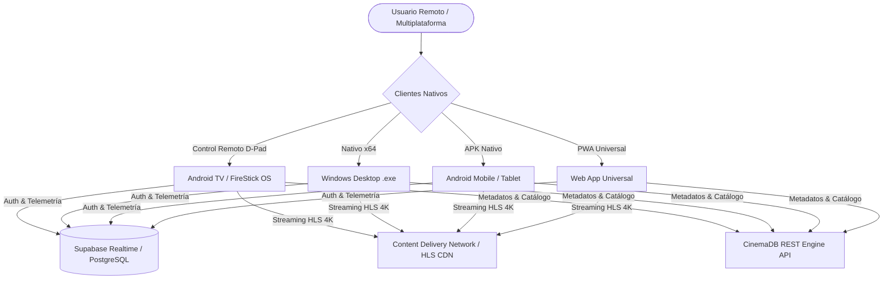
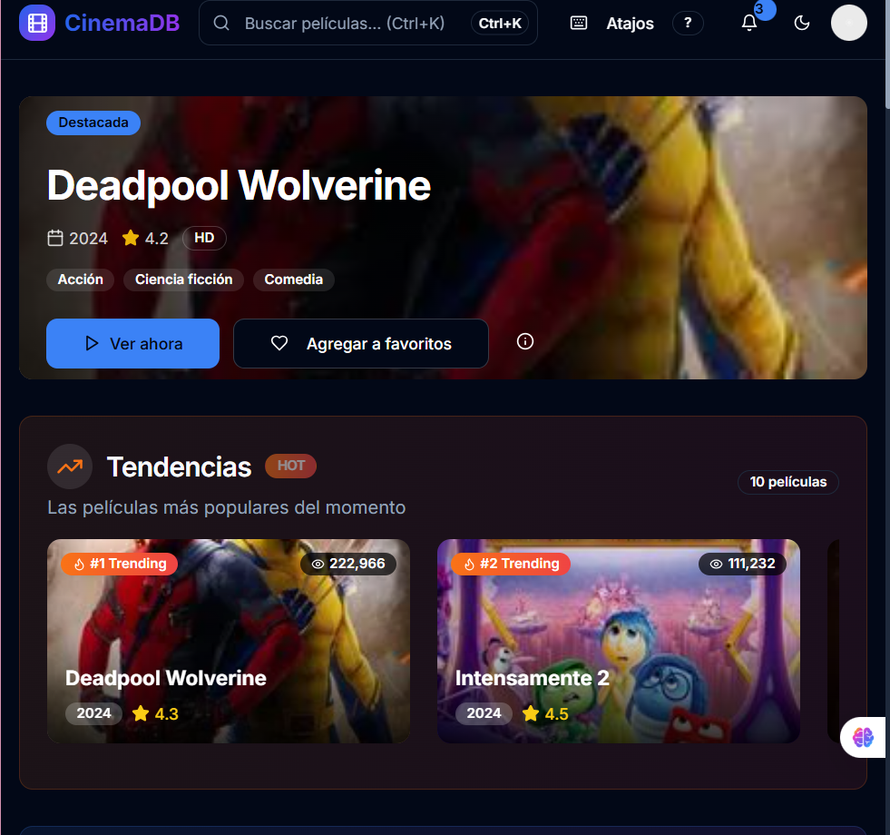
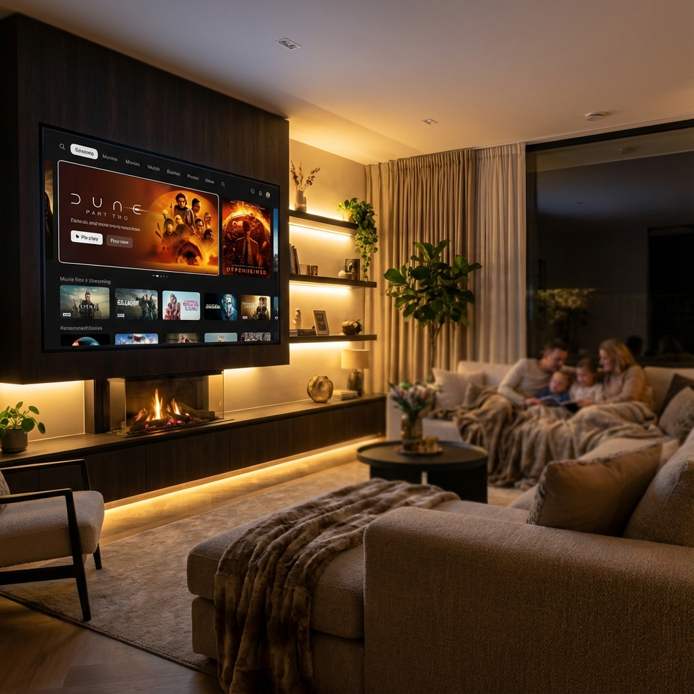
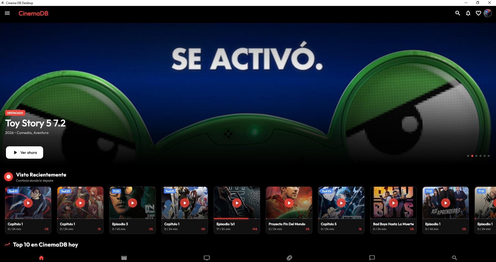
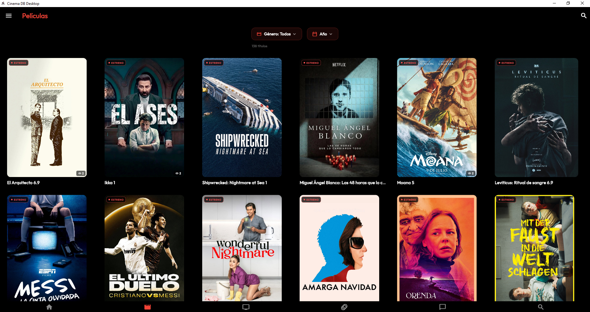
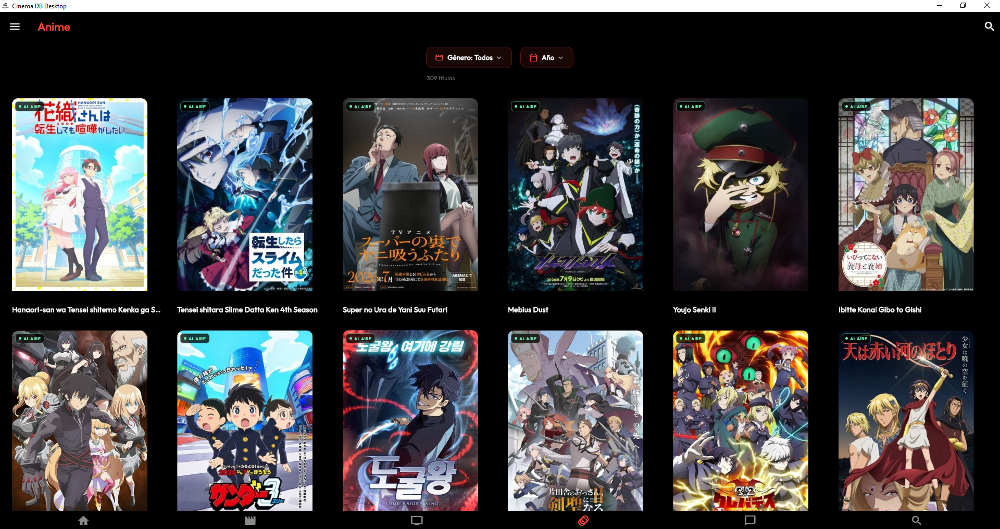
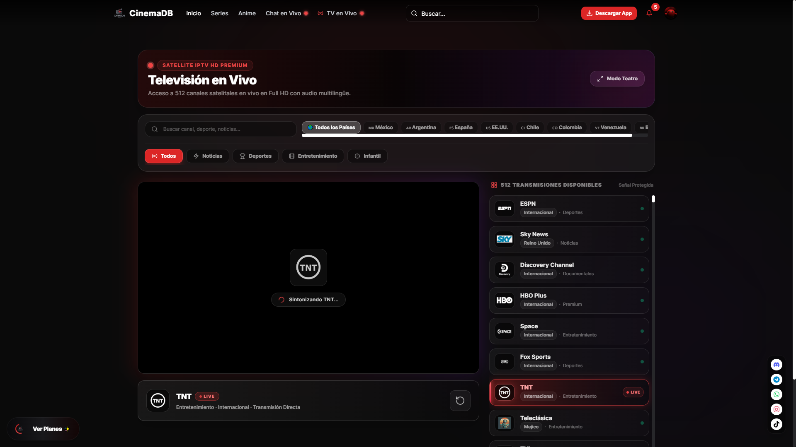

# CinemaDB (CineMás TV) - Ecosistema de Streaming Multiplataforma

### 🏢 Proyecto Desarrollado por **BVX LAB**
*Create. Develop. Grow. // Punta Cana, República Dominicana*

 [_261--6367-25D366?style=for-the-badge&logo=whatsapp&logoColor=white)](https://wa.me/18492616367) 

---

## 📌 Ficha Técnica del Proyecto

| Concepto | Detalle |
| :--- | :--- |
| **Nombre del Proyecto** | **CinemaDB (CineMás TV) - Ecosistema de Streaming Multiplataforma** |
| **Categoría** | Streaming & Multiplataforma |
| **Tiempo de Desarrollo** | ⏱️ **6 semanas** |
| **Enlace / URL Oficial** | 🌐 [cinemadb.club](https://cinemadb.club) |
| **Empresa Desarrolladora** | [BVX LAB](https://github.com/bvxlabs) |
| **Contacto Directo** | WhatsApp: [+1 (849) 261-6367](https://wa.me/18492616367) |

### 🌐 Enlaces y Canales Oficiales
- **Instagram BVX:** [https://www.instagram.com/bvxlaps/](https://www.instagram.com/bvxlaps/)
- **WhatsApp Cotizaciones:** [https://wa.me/18492616367](https://wa.me/18492616367)
- **TikTok:** [https://www.tiktok.com/@lisersk](https://www.tiktok.com/@lisersk)
- **Acceso en Vivo:** [https://cinemadb.club](https://cinemadb.club)

---

## 📖 Resumen Ejecutivo & Alcance

Plataforma completa de streaming de contenido multimedia bajo demanda y canales en vivo (Live TV). Arquitectura nativa desarrollada en Flutter con soporte especializado para navegación remota D-Pad en Smart TVs, ejecutables para Windows PC (.exe), Android APK, Web PWA y backend reactivo con Supabase y PostgreSQL.

## 🛠️ Stack Tecnológico & Arquitectura

- 🔹 **Flutter Native**
- 🔹 **Smart TV D-Pad Engine**
- 🔹 **Windows .exe (Desktop)**
- 🔹 **PostgreSQL / Supabase Realtime**
- 🔹 **HLS 4K Video Player**
- 🔹 **Node.js / Express**
- 🔹 **REST API**

## 📊 Métricas & Resultados Clave

| Métrica | Valor |
| :--- | :--- |
| **Dispositivos Activos** | `+3,425 Online` |
| **Descargas APK** | `+2,936 Descargas` |
| **Catálogo Multimedia** | `+8,100 Episodios & Películas` |
| **Resolución Video** | `HLS Adaptativo hasta 4K 60fps` |

---

## 📐 Diagrama de Arquitectura & Flujo de Datos

---

## 📸 Evidencias Visuales & Capturas del Proyecto

### 🖼️ 00_CinemaDB_Deadpool_Hero.png

### 🖼️ promo_tv.png

### 🖼️ desktop_home.png

### 🖼️ desktop_movies.png

### 🖼️ desktop_series.png

### 🖼️ desktop_anime.png

### 🖼️ desktop_livetv.png

### 🖼️ desktop_chat.png

---

**¿Deseas implementar una solución similar para tu empresa?**  
[Contáctanos directamente vía WhatsApp](https://wa.me/18492616367?text=Hola%20BVX%20LAB,%20me%20interesa%20un%20proyecto%20como%20CinemaDB%20%2F%20CineM%C3%A1s%20TV)  

**BVX LAB** · *High-Performance Software, AI & Engineering*

