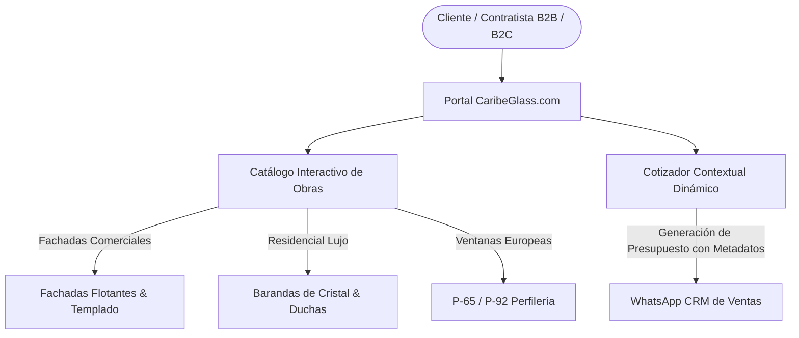
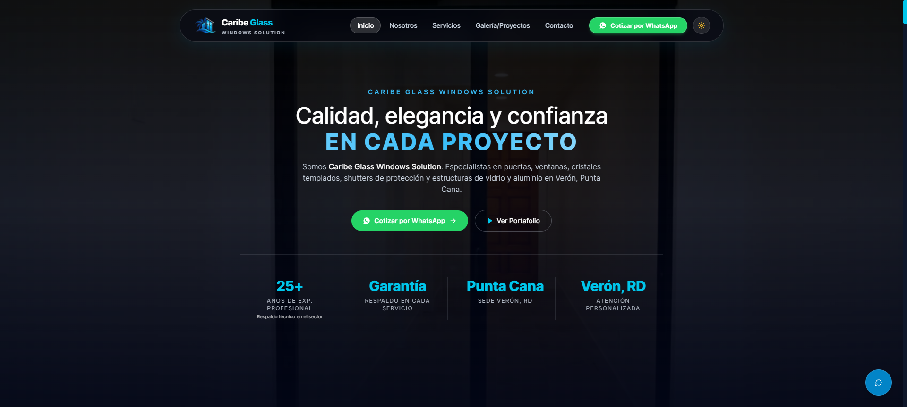
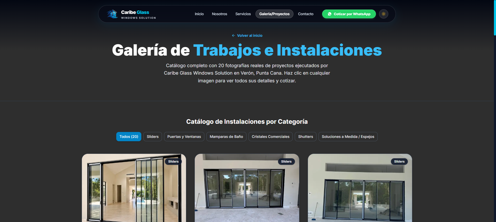

# Caribe Glass - Plataforma Corporativa & Catálogo Arquitectónico de Cristal

### 🏢 Proyecto Desarrollado por **BVX LAB**
*Create. Develop. Grow. // Punta Cana, República Dominicana*

  [_654--8277-25D366?style=for-the-badge&logo=whatsapp&logoColor=white)](https://wa.me/18296548277) 

---

## 📌 Ficha Técnica del Proyecto

| Concepto | Detalle |
| :--- | :--- |
| **Nombre del Proyecto** | **Caribe Glass - Plataforma Corporativa & Catálogo Arquitectónico de Cristal** |
| **Categoría** | Solución Empresarial B2B / B2C |
| **Tiempo de Desarrollo** | ⏱️ **2 semanas** |
| **Enlace / URL Oficial** | 🌐 [caribeglass.com](https://caribeglass.com/) |
| **Empresa Desarrolladora** | [BVX LAB](https://github.com/bvxlabs) |
| **Contacto Directo** | WhatsApp: [+1 (829) 654-8277](https://wa.me/18296548277) · Tel: [+1 (849) 261-6367](tel:18492616367) |

### 🌐 Enlaces y Canales Oficiales
- **Instagram Oficial:** [https://www.instagram.com/caribe__glass/](https://www.instagram.com/caribe__glass/)
- **Instagram BVX:** [https://www.instagram.com/bvxlaps/](https://www.instagram.com/bvxlaps/)
- **WhatsApp Directo:** [https://wa.me/18296548277](https://wa.me/18296548277)
- **Acceso en Vivo:** [https://caribeglass.com/](https://caribeglass.com/)

---

## 📖 Resumen Ejecutivo & Alcance

Ecosistema web corporativo para fábrica y distribuidora de cristales templados, fachadas flotantes de aluminio comercial, barandas de acero inoxidable y cabinas de baño en República Dominicana. Incluye catálogo interactivo con filtrado de proyectos arquitectónicos y cotizador directo vía WhatsApp CRM contextual.

## 🛠️ Stack Tecnológico & Arquitectura

- 🔹 **React 19**
- 🔹 **TypeScript**
- 🔹 **Tailwind CSS v4**
- 🔹 **Vite**
- 🔹 **Lucide Icons**
- 🔹 **WhatsApp Business CRM API**
- 🔹 **Netlify Edge CDN**

## 📊 Métricas & Resultados Clave

| Métrica | Valor |
| :--- | :--- |
| **Tiempo de Carga** | `< 0.8s Ultra-Fast` |
| **Retención Móvil** | `98% Mobile Friendly` |
| **Canal de Conversión** | `WhatsApp Direct Lead Generation` |
| **Mercado** | `República Dominicana (Nacional)` |

---

## 📐 Diagrama de Arquitectura & Flujo de Datos

---

## 📸 Evidencias Visuales & Capturas del Proyecto

### 🖼️ 01-home-hero.png

### 🖼️ 01-galeria.png

---

**¿Deseas implementar una solución similar para tu empresa?**  
[Contáctanos directamente vía WhatsApp](https://wa.me/18296548277?text=Hola%20BVX%20LAB,%20me%20interesa%20un%20proyecto%20como%20Caribe%20Glass%20Windows%20Solution)  

**BVX LAB** · *High-Performance Software, AI & Engineering*

