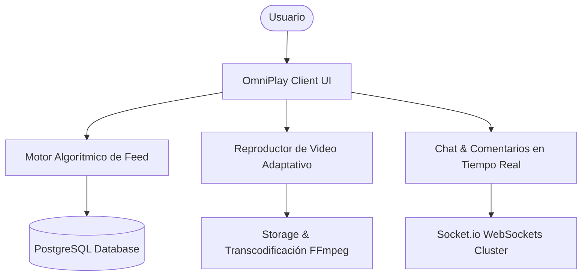
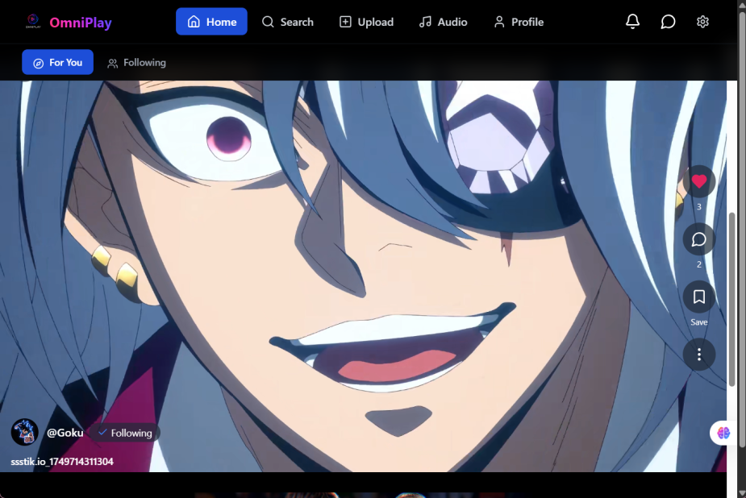
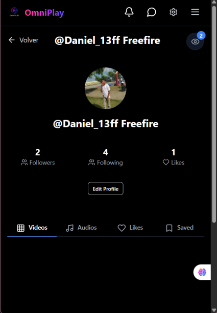
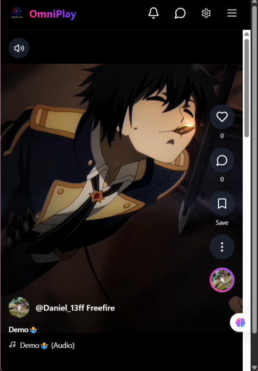

# OmniPlay - Plataforma de Video Streaming & Red Social Multimedia

### 🏢 Proyecto Desarrollado por **BVX LAB**
*Create. Develop. Grow. // Punta Cana, República Dominicana*

  [_261--6367-25D366?style=for-the-badge&logo=whatsapp&logoColor=white)](https://wa.me/18492616367) 

---

## 📌 Ficha Técnica del Proyecto

| Concepto | Detalle |
| :--- | :--- |
| **Nombre del Proyecto** | **OmniPlay - Plataforma de Video Streaming & Red Social Multimedia** |
| **Categoría** | Red Social & Video Streaming |
| **Tiempo de Desarrollo** | ⏱️ **4 semanas** |
| **Enlace / URL Oficial** | 🔒 *Módulo de Producción BVX (Privado / Uso Empresarial)* |
| **Empresa Desarrolladora** | [BVX LAB](https://github.com/bvxlabs) |
| **Contacto Directo** | WhatsApp: [+1 (849) 261-6367](https://wa.me/18492616367) |

### 🌐 Enlaces y Canales Oficiales
- **Instagram BVX:** [https://www.instagram.com/bvxlaps/](https://www.instagram.com/bvxlaps/)
- **WhatsApp Cotizaciones:** [https://wa.me/18492616367](https://wa.me/18492616367)

---

## 📖 Resumen Ejecutivo & Alcance

Red social interactiva con centro de streaming de video, feeds algorítmicos dinámicos, perfiles de creadores de contenido, gestión de suscripciones, comentarios en tiempo real y transcodificación de medios optimizada para consumo móvil y desktop.

## 🛠️ Stack Tecnológico & Arquitectura

- 🔹 **React**
- 🔹 **TypeScript**
- 🔹 **Node.js**
- 🔹 **Socket.io Realtime**
- 🔹 **Tailwind CSS**
- 🔹 **PostgreSQL**
- 🔹 **FFmpeg Transcoding**

## 📊 Métricas & Resultados Clave

| Métrica | Valor |
| :--- | :--- |
| **Latencia Streaming** | `< 250ms` |
| **Render UI** | `60 FPS` |
| **Arquitectura** | `Microservicios de Video y Feeds` |

---

## 📐 Diagrama de Arquitectura & Flujo de Datos

---

## 📸 Evidencias Visuales & Capturas del Proyecto

### 🖼️ 01_onmiplay_feed.png

### 🖼️ 02_onmiplay_perfil.png

### 🖼️ 03_onmiplay_home.png

---

**¿Deseas implementar una solución similar para tu empresa?**  
[Contáctanos directamente vía WhatsApp](https://wa.me/18492616367?text=Hola%20BVX%20LAB,%20me%20interesa%20un%20proyecto%20como%20OmniPlay%20Video%20Social)  

**BVX LAB** · *High-Performance Software, AI & Engineering*

