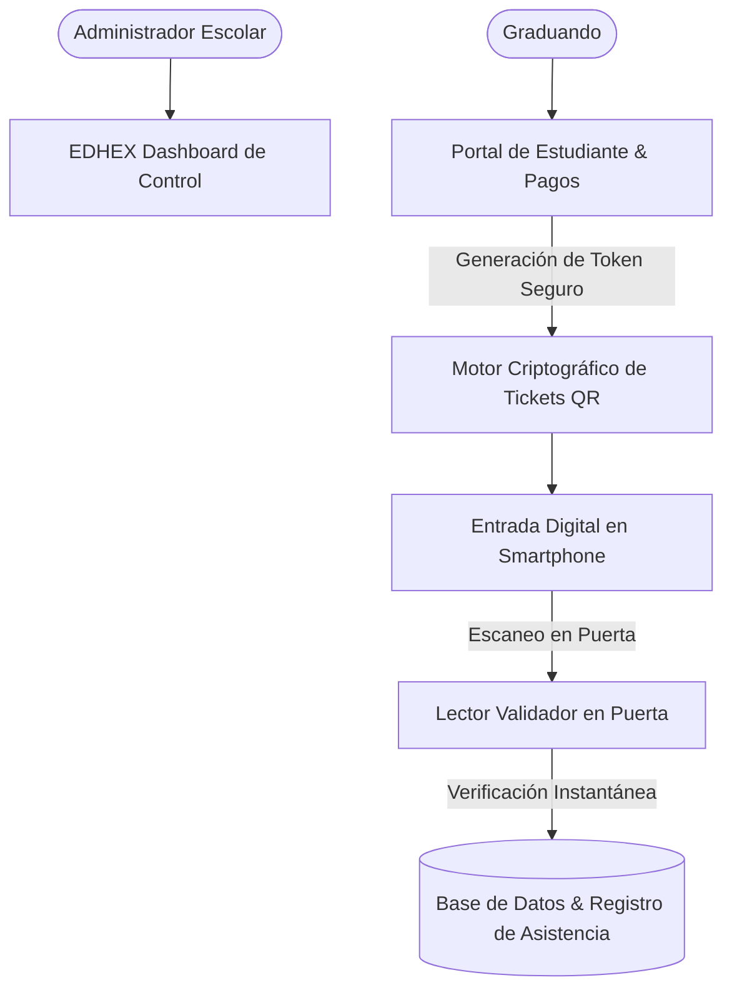
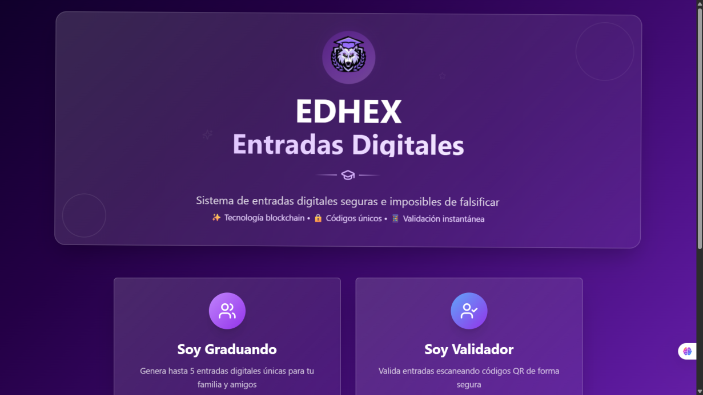
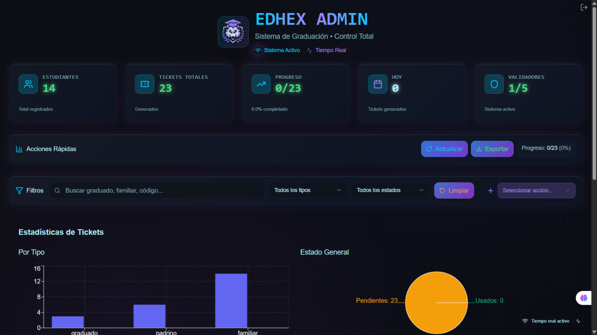

# EDHEX - Sistema de Gestión de Graduación & Entradas Digitales

### 🏢 Proyecto Desarrollado por **BVX LAB**
*Create. Develop. Grow. // Punta Cana, República Dominicana*

 [_261--6367-25D366?style=for-the-badge&logo=whatsapp&logoColor=white)](https://wa.me/18492616367) 

---

## 📌 Ficha Técnica del Proyecto

| Concepto | Detalle |
| :--- | :--- |
| **Nombre del Proyecto** | **EDHEX - Sistema de Gestión de Graduación & Entradas Digitales** |
| **Categoría** | Fintech & Gestión Académica |
| **Tiempo de Desarrollo** | ⏱️ **3 semanas** |
| **Enlace / URL Oficial** | 🔒 *Sistema Institucional Privado (Privado / Uso Empresarial)* |
| **Empresa Desarrolladora** | [BVX LAB](https://github.com/bvxlabs) |
| **Contacto Directo** | WhatsApp: [+1 (849) 261-6367](https://wa.me/18492616367) |

### 🌐 Enlaces y Canales Oficiales
- **Instagram BVX:** [https://www.instagram.com/bvxlaps/](https://www.instagram.com/bvxlaps/)
- **WhatsApp:** [https://wa.me/18492616367](https://wa.me/18492616367)

---

## 📖 Resumen Ejecutivo & Alcance

Plataforma administrativa y portal para graduandos con emisión de boletos y pases digitales con código QR criptográfico para control de acceso en auditorios, dashboard gerencial de pagos, validación en puerta en tiempo real y registro de egresados.

## 🛠️ Stack Tecnológico & Arquitectura

- 🔹 **React**
- 🔹 **Node.js / Express**
- 🔹 **QR Cryptography Engine**
- 🔹 **Tailwind CSS**
- 🔹 **PostgreSQL**
- 🔹 **Supabase Auth**

## 📊 Métricas & Resultados Clave

| Métrica | Valor |
| :--- | :--- |
| **Tasa de Validación** | `< 0.5s por código QR` |
| **Seguridad** | `Tokens anticopia de un solo uso` |
| **Control** | `Dashboard Administrativo Multi-rol` |

---

## 📐 Diagrama de Arquitectura & Flujo de Datos

---

## 📸 Evidencias Visuales & Capturas del Proyecto

### 🖼️ 01_edhex_entradas_digitales.png

### 🖼️ 02_edhex_admin_dashboard.png

---

**¿Deseas implementar una solución similar para tu empresa?**  
[Contáctanos directamente vía WhatsApp](https://wa.me/18492616367?text=Hola%20BVX%20LAB,%20me%20interesa%20un%20proyecto%20como%20EDHEX%20Graduaciones)  

**BVX LAB** · *High-Performance Software, AI & Engineering*

