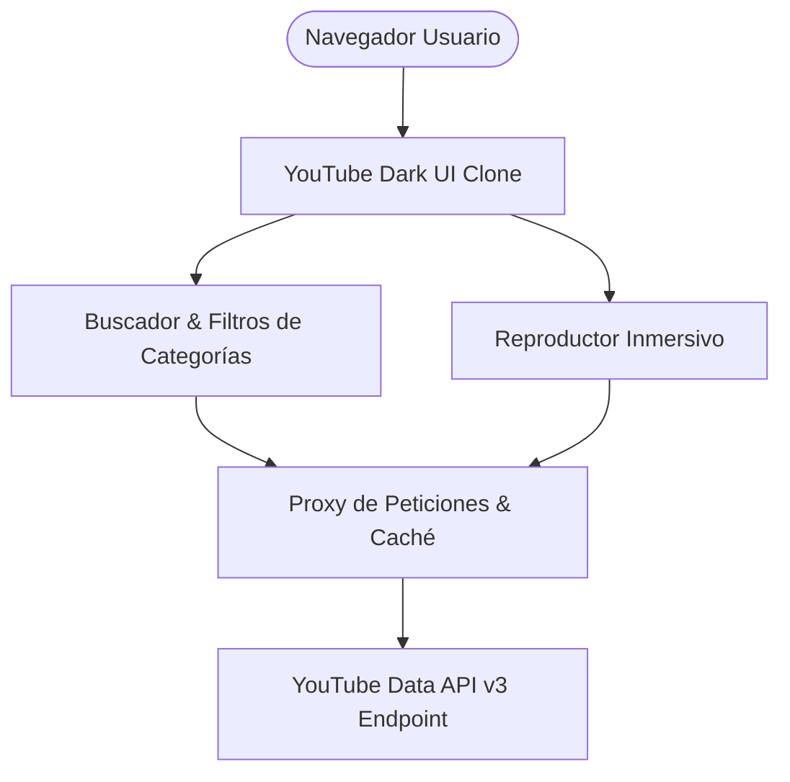

# YouTube Core Platform Clone - Arquitectura Frontend de Alto Rendimiento

### 🏢 Proyecto Desarrollado por **BVX LAB**
*Create. Develop. Grow. // Punta Cana, República Dominicana*

  [_261--6367-25D366?style=for-the-badge&logo=whatsapp&logoColor=white)](https://wa.me/18492616367) 

---

## 📌 Ficha Técnica del Proyecto

| Concepto | Detalle |
| :--- | :--- |
| **Nombre del Proyecto** | **YouTube Core Platform Clone - Arquitectura Frontend de Alto Rendimiento** |
| **Categoría** | Arquitectura Web Multimedia |
| **Tiempo de Desarrollo** | ⏱️ **2 semanas** |
| **Enlace / URL Oficial** | 🔒 *Arquitectura Demo BVX (Privado / Uso Empresarial)* |
| **Empresa Desarrolladora** | [BVX LAB](https://github.com/bvxlabs) |
| **Contacto Directo** | WhatsApp: [+1 (849) 261-6367](https://wa.me/18492616367) |

### 🌐 Enlaces y Canales Oficiales
- **Instagram BVX:** [https://www.instagram.com/bvxlaps/](https://www.instagram.com/bvxlaps/)
- **GitHub Autor:** [https://github.com/Wwb-Daniel](https://github.com/Wwb-Daniel)

---

## 📖 Resumen Ejecutivo & Alcance

Recreación de nivel de producción de la interfaz de YouTube con tema oscuro de alta fidelidad, integración de la YouTube Data API v3, barra de navegación fluida, categorización de videos dinámica, reproductor flotante inmersivo y diseño completamente responsivo.

## 🛠️ Stack Tecnológico & Arquitectura

- 🔹 **React**
- 🔹 **TypeScript**
- 🔹 **YouTube Data API v3**
- 🔹 **Tailwind CSS**
- 🔹 **Axios**
- 🔹 **Lucide React**

## 📊 Métricas & Resultados Clave

| Métrica | Valor |
| :--- | :--- |
| **Fidelidad Visual** | `100% Dark Mode YouTube HIG` |
| **Consumo API** | `Caché reactiva con reducción de cuota` |
| **Velocidad de Carga** | `< 1.1s` |

---

## 📐 Diagrama de Arquitectura & Flujo de Datos

---

## 📸 Evidencias Visuales & Capturas del Proyecto

### 🖼️ 01_youtube_dark_home.png

---

**¿Deseas implementar una solución similar para tu empresa?**  
[Contáctanos directamente vía WhatsApp](https://wa.me/18492616367?text=Hola%20BVX%20LAB,%20me%20interesa%20un%20proyecto%20como%20YouTube%20Frontend%20Core)  

**BVX LAB** · *High-Performance Software, AI & Engineering*

