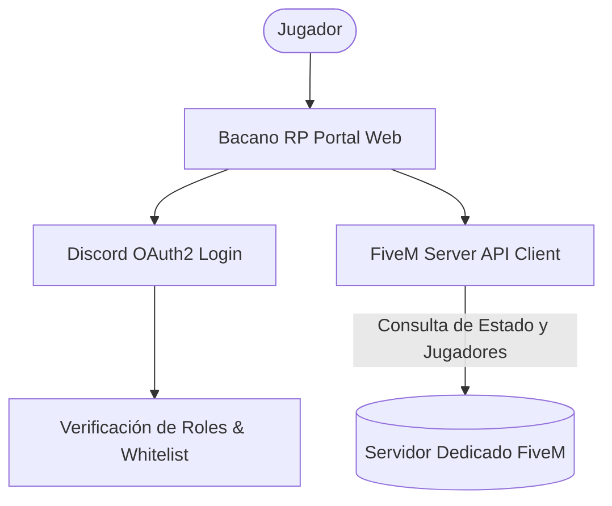
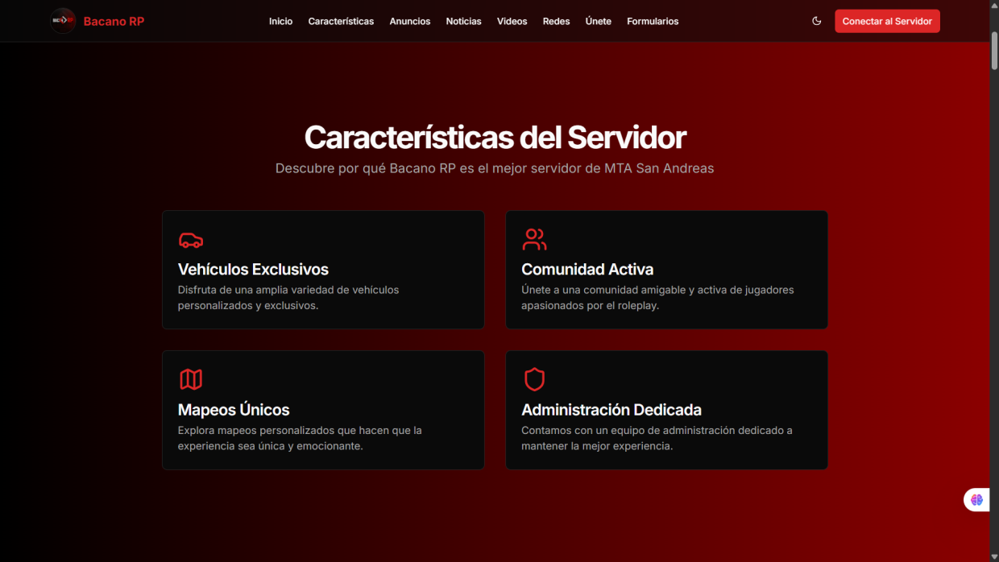

# Bacano Roleplay - Portal Comunitario, Sincronización FiveM & OAuth2

### 🏢 Proyecto Desarrollado por **BVX LAB**
*Create. Develop. Grow. // Punta Cana, República Dominicana*

  [_654--8277-25D366?style=for-the-badge&logo=whatsapp&logoColor=white)](https://wa.me/18296548277) 

---

## 📌 Ficha Técnica del Proyecto

| Concepto | Detalle |
| :--- | :--- |
| **Nombre del Proyecto** | **Bacano Roleplay - Portal Comunitario, Sincronización FiveM & OAuth2** |
| **Categoría** | Gaming & Comunidad Virtual |
| **Tiempo de Desarrollo** | ⏱️ **2 semanas** |
| **Enlace / URL Oficial** | 🔒 *Servidor Privado Gaming (Privado / Uso Empresarial)* |
| **Empresa Desarrolladora** | [BVX LAB](https://github.com/bvxlabs) |
| **Contacto Directo** | WhatsApp: [+1 (829) 654-8277](https://wa.me/18296548277) · Tel: [+1 (849) 261-6367](tel:18492616367) |

### 🌐 Enlaces y Canales Oficiales
- **Instagram BVX:** [https://www.instagram.com/bvxlaps/](https://www.instagram.com/bvxlaps/)
- **WhatsApp:** [https://wa.me/18296548277](https://wa.me/18296548277)

---

## 📖 Resumen Ejecutivo & Alcance

Plataforma oficial para comunidad de videojuego de rol GTA V FiveM. Sincronización directa con el servidor de juego, sistema de autenticación OAuth2 con Discord, visualizador de jugadores conectados en vivo, gestión de whitelist y reglas comunitarias.

## 🛠️ Stack Tecnológico & Arquitectura

- 🔹 **React**
- 🔹 **Node.js**
- 🔹 **Discord OAuth2 API**
- 🔹 **FiveM Server JSON API**
- 🔹 **Tailwind CSS**
- 🔹 **Vite**

## 📊 Métricas & Resultados Clave

| Métrica | Valor |
| :--- | :--- |
| **Sincronización** | `Polling dinámico de slots del servidor en vivo` |
| **Integración** | `Verificación de roles en Discord en tiempo real` |
| **Experiencia** | `Diseño temático Cyber/Gaming` |

---

## 📐 Diagrama de Arquitectura & Flujo de Datos

---

## 📸 Evidencias Visuales & Capturas del Proyecto

### 🖼️ 01_bacano_rp_servidor.png

---

**¿Deseas implementar una solución similar para tu empresa?**  
[Contáctanos directamente vía WhatsApp](https://wa.me/18296548277?text=Hola%20BVX%20LAB,%20me%20interesa%20un%20proyecto%20como%20Bacano%20Roleplay%20FiveM%20Hub)  

**BVX LAB** · *High-Performance Software, AI & Engineering*

