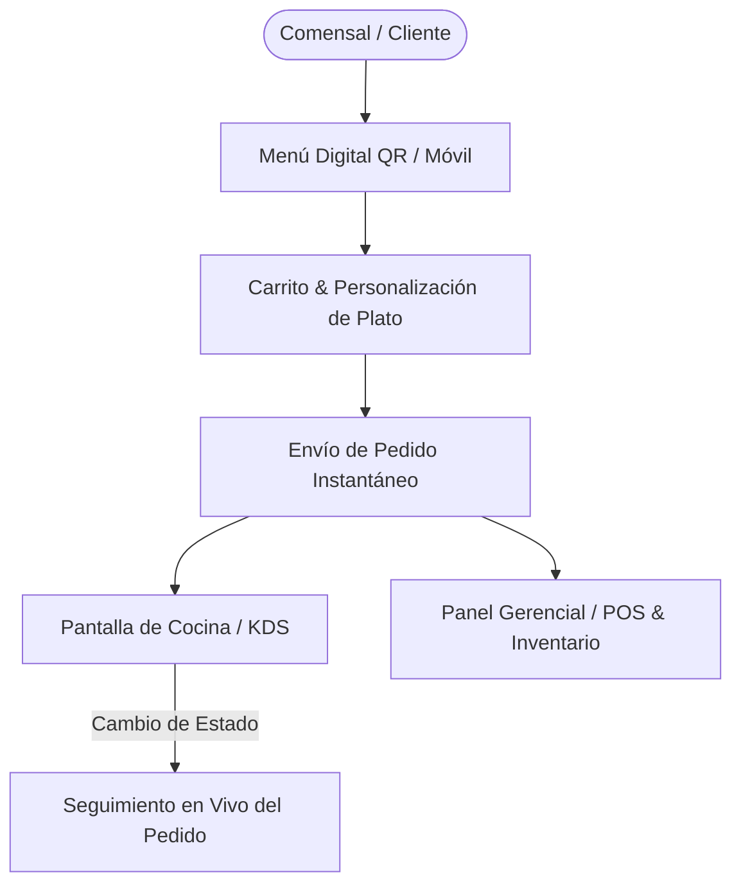
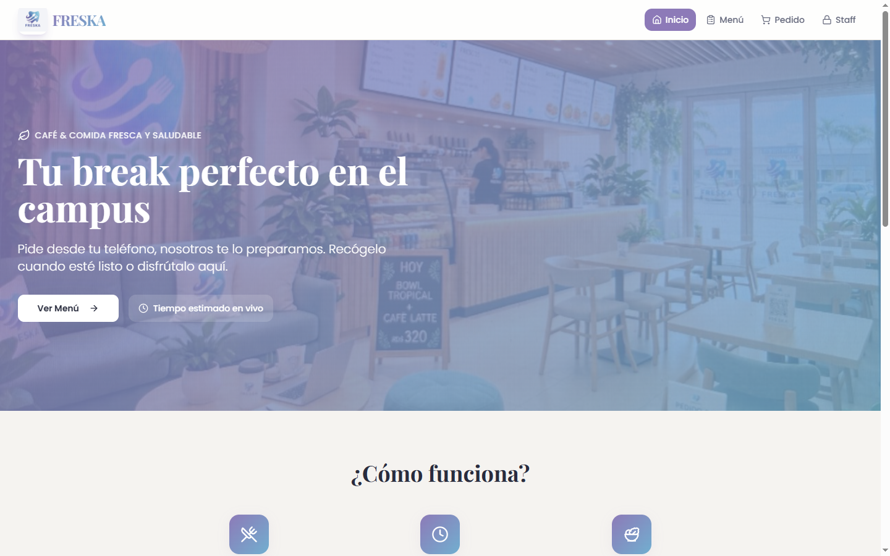
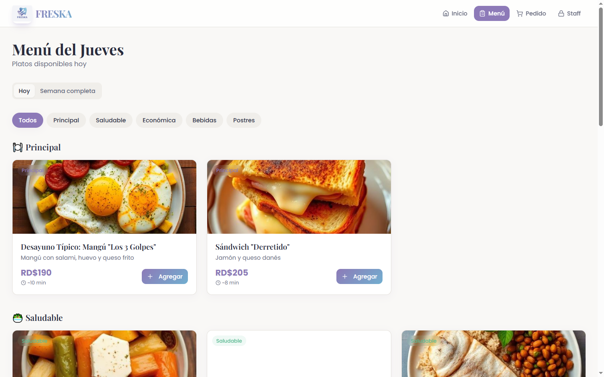
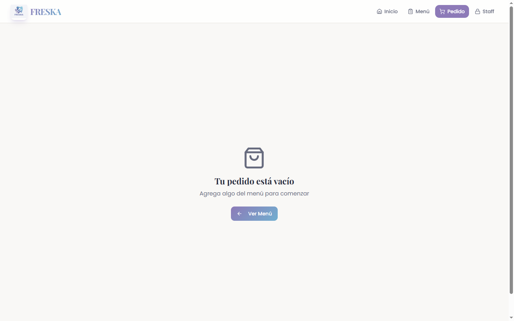
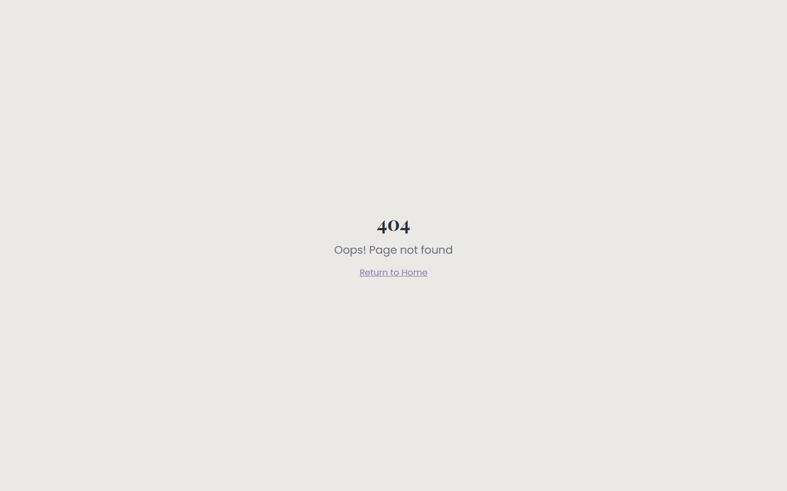
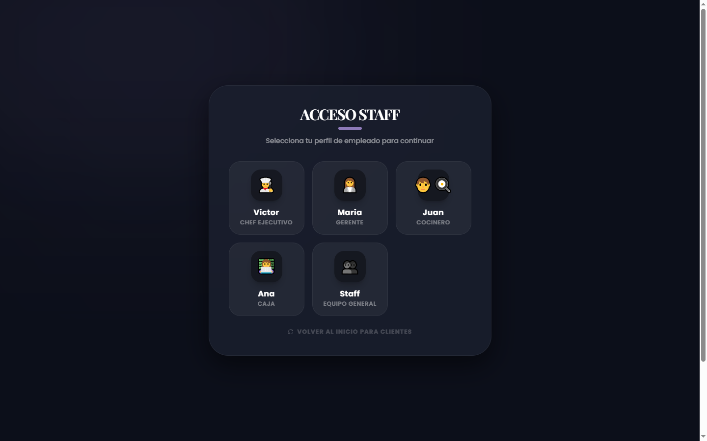

# Freska / Orderly Eats - Punto de Venta (POS) & Pedidos para Restaurantes

### 🏢 Proyecto Desarrollado por **BVX LAB**
*Create. Develop. Grow. // Punta Cana, República Dominicana*

  [_261--6367-25D366?style=for-the-badge&logo=whatsapp&logoColor=white)](https://wa.me/18492616367) 

---

## 📌 Ficha Técnica del Proyecto

| Concepto | Detalle |
| :--- | :--- |
| **Nombre del Proyecto** | **Freska / Orderly Eats - Punto de Venta (POS) & Pedidos para Restaurantes** |
| **Categoría** | E-Commerce & GastroTech POS |
| **Tiempo de Desarrollo** | ⏱️ **3 semanas** |
| **Enlace / URL Oficial** | 🔒 *GastroTech Solution BVX (Privado / Uso Empresarial)* |
| **Empresa Desarrolladora** | [BVX LAB](https://github.com/bvxlabs) |
| **Contacto Directo** | WhatsApp: [+1 (849) 261-6367](https://wa.me/18492616367) |

### 🌐 Enlaces y Canales Oficiales
- **Instagram BVX:** [https://www.instagram.com/bvxlaps/](https://www.instagram.com/bvxlaps/)
- **WhatsApp Soluciones:** [https://wa.me/18492616367](https://wa.me/18492616367)

---

## 📖 Resumen Ejecutivo & Alcance

Sistema integral de menú digital interactivo, carrito de compras en tiempo real, gestión de estados de órdenes de cocina (preparación, listo, servido) y panel de administración para restaurantes y bares con control de inventario.

## 🛠️ Stack Tecnológico & Arquitectura

- 🔹 **React**
- 🔹 **TypeScript**
- 🔹 **Tailwind CSS**
- 🔹 **Zustand State Management**
- 🔹 **Supabase Realtime**
- 🔹 **Thermal Printing Engine**

## 📊 Métricas & Resultados Clave

| Métrica | Valor |
| :--- | :--- |
| **Actualización de Comandas** | `Instantáneo vía WebSockets (<50ms)` |
| **Optimización de Pedidos** | `Reducción de espera en un 35%` |
| **UX** | `Diseño táctil y optimizado para tablets de servicio` |

---

## 📐 Diagrama de Arquitectura & Flujo de Datos

---

## 📸 Evidencias Visuales & Capturas del Proyecto

### 🖼️ 03-freska-home.png

### 🖼️ 03-freska-menu.png

### 🖼️ 03-freska-cart.png

### 🖼️ 03-freska-order-status.png

### 🖼️ 03-freska-admin.png

---

**¿Deseas implementar una solución similar para tu empresa?**  
[Contáctanos directamente vía WhatsApp](https://wa.me/18492616367?text=Hola%20BVX%20LAB,%20me%20interesa%20un%20proyecto%20como%20Freska%20POS%20%26%20Restaurant%20Orders)  

**BVX LAB** · *High-Performance Software, AI & Engineering*

