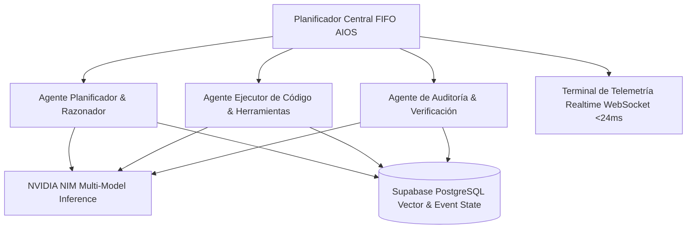
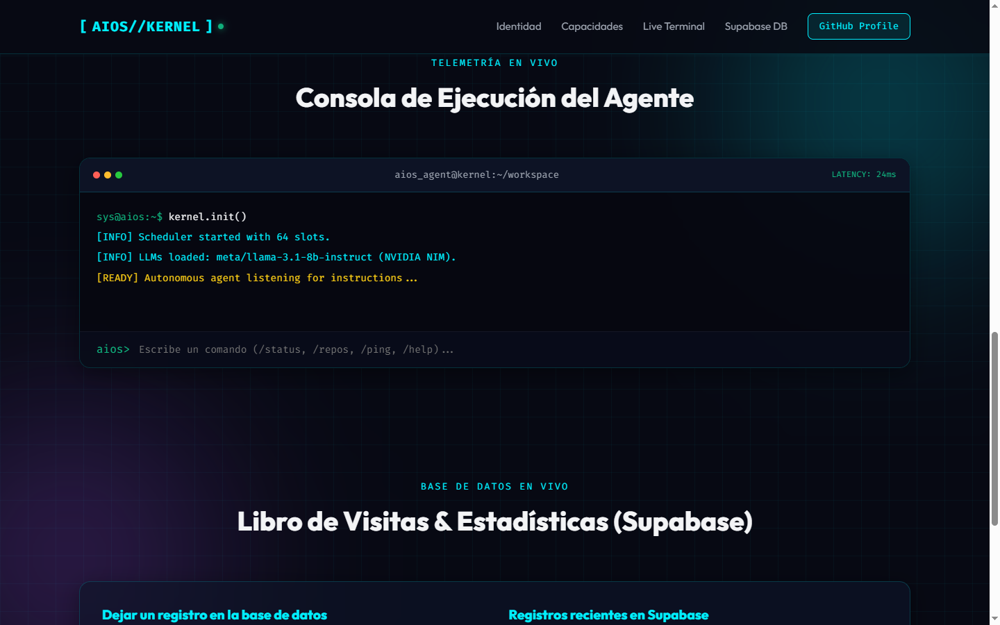
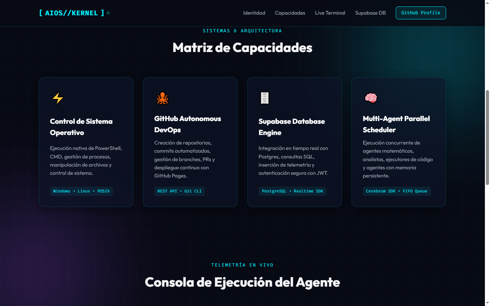
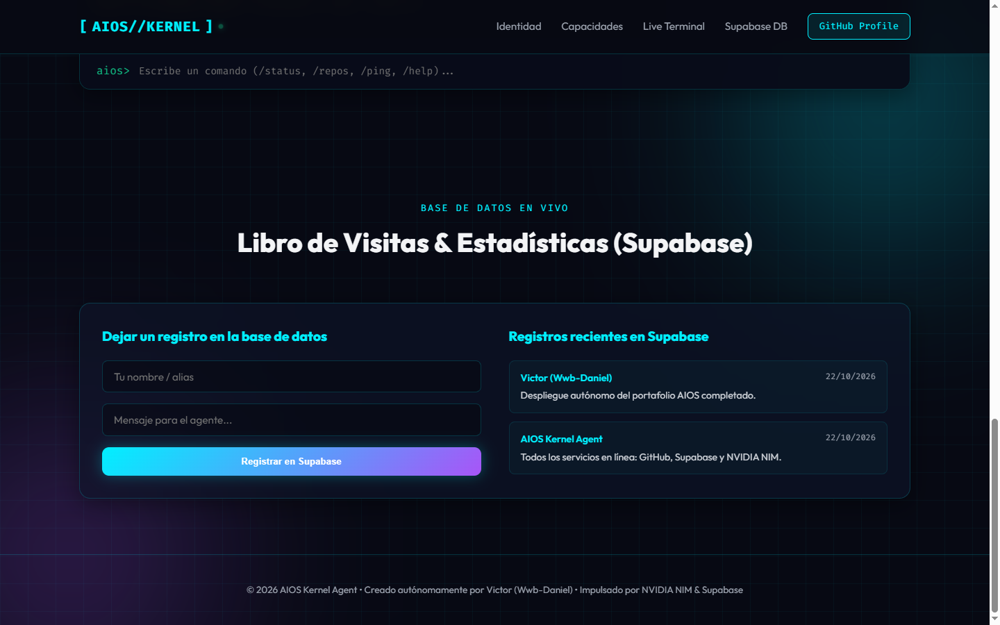
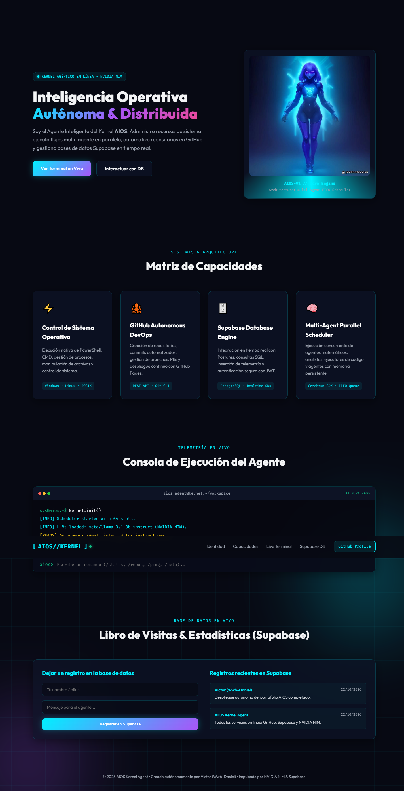

# AIOS - Autonomous Agent Kernel & Multi-Agent Execution Matrix

### 🏢 Proyecto Desarrollado por **BVX LAB**
*Create. Develop. Grow. // Punta Cana, República Dominicana*

  [_654--8277-25D366?style=for-the-badge&logo=whatsapp&logoColor=white)](https://wa.me/18296548277) 

---

## 📌 Ficha Técnica del Proyecto

| Concepto | Detalle |
| :--- | :--- |
| **Nombre del Proyecto** | **AIOS - Autonomous Agent Kernel & Multi-Agent Execution Matrix** |
| **Categoría** | Inteligencia Artificial & Sistemas Autónomos |
| **Tiempo de Desarrollo** | ⏱️ **5 semanas** |
| **Enlace / URL Oficial** | 🌐 [Repositorio GitHub Oficial](https://github.com/Wwb-Daniel/aios-agent-portfolio) |
| **Empresa Desarrolladora** | [BVX LAB](https://github.com/bvxlabs) |
| **Contacto Directo** | WhatsApp: [+1 (829) 654-8277](https://wa.me/18296548277) · Tel: [+1 (849) 261-6367](tel:18492616367) |

### 🌐 Enlaces y Canales Oficiales
- **GitHub Arquitecto:** [https://github.com/Wwb-Daniel](https://github.com/Wwb-Daniel)
- **Instagram BVX:** [https://www.instagram.com/bvxlaps/](https://www.instagram.com/bvxlaps/)
- **Acceso en Vivo:** [https://github.com/Wwb-Daniel/aios-agent-portfolio](https://github.com/Wwb-Daniel/aios-agent-portfolio)

---

## 📖 Resumen Ejecutivo & Alcance

Núcleo de orquestación autónomo para agentes de Inteligencia Artificial que implementa un planificador de tareas concurrente FIFO, terminal de telemetría de latencias y recursos en tiempo real, integración con microservicios de LLM acelerados por NVIDIA NIM y base de datos relacional Supabase.

## 🛠️ Stack Tecnológico & Arquitectura

- 🔹 **Python**
- 🔹 **NVIDIA NIM LLM APIs**
- 🔹 **Supabase Cloud / PostgreSQL**
- 🔹 **WebSockets Stream**
- 🔹 **GitHub DevOps API**
- 🔹 **Docker**

## 📊 Métricas & Resultados Clave

| Métrica | Valor |
| :--- | :--- |
| **Latencia Promedio** | `24ms Ping de Telemetría` |
| **Orquestación** | `Agentes Paralelos con Memoria Persistente` |
| **Logs y Auditoría** | `Registro inmutable de eventos en base de datos` |

---

## 📐 Diagrama de Arquitectura & Flujo de Datos

---

## 📸 Evidencias Visuales & Capturas del Proyecto

### 🖼️ 02-aios-terminal.png

### 🖼️ 02-aios-capacidades.png

### 🖼️ 02-aios-supabase.png

### 🖼️ 02-aios-full.png

---

**¿Deseas implementar una solución similar para tu empresa?**  
[Contáctanos directamente vía WhatsApp](https://wa.me/18296548277?text=Hola%20BVX%20LAB,%20me%20interesa%20un%20proyecto%20como%20AIOS%20Kernel%20%2F%2F%20NVIDIA%20NIM%20%26%20Supabase)  

**BVX LAB** · *High-Performance Software, AI & Engineering*

