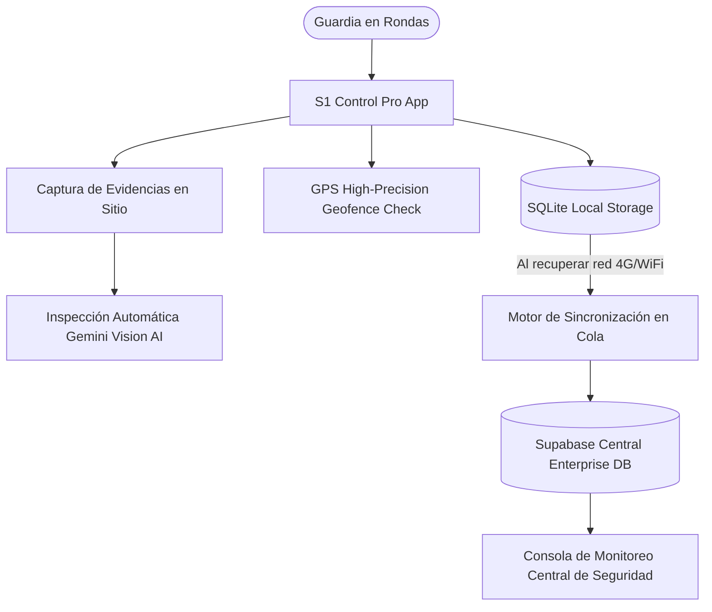
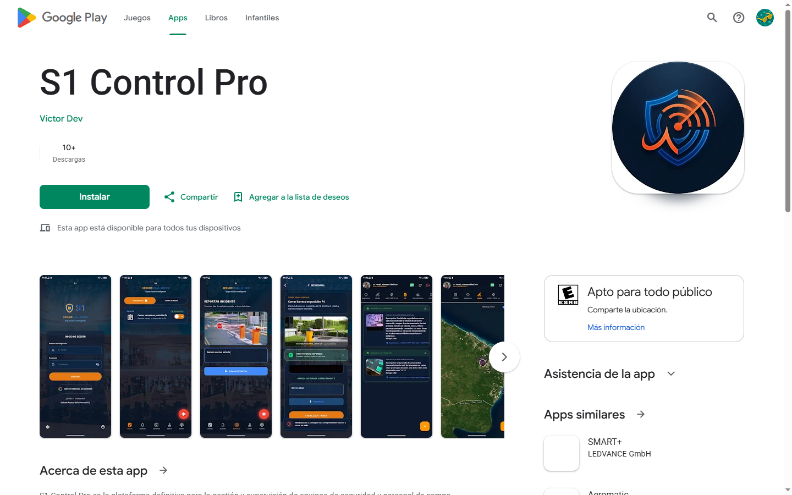
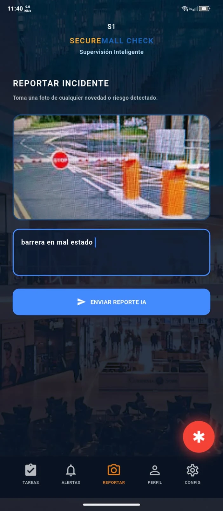
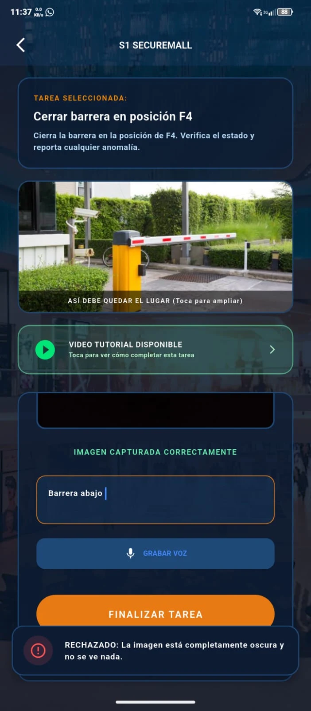
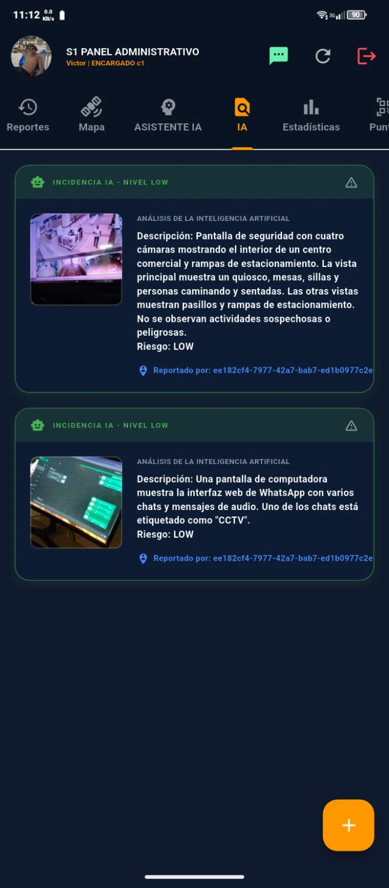
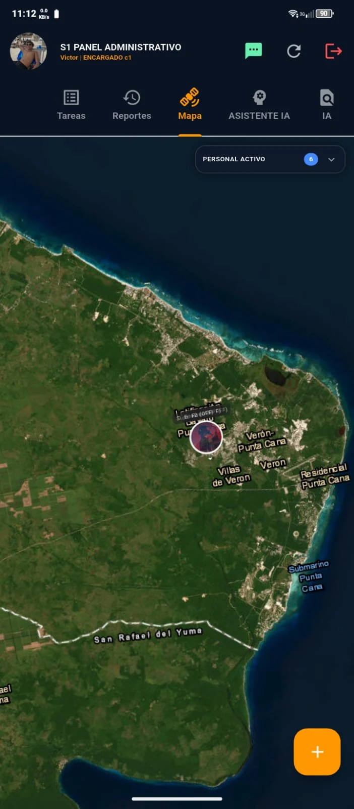

# S1 Control Pro - Seguridad Física, Geofencing GPS & Computer Vision en Google Play

### 🏢 Proyecto Desarrollado por **BVX LAB**
*Create. Develop. Grow. // Punta Cana, República Dominicana*

  [_654--8277-25D366?style=for-the-badge&logo=whatsapp&logoColor=white)](https://wa.me/18296548277) 

---

## 📌 Ficha Técnica del Proyecto

| Concepto | Detalle |
| :--- | :--- |
| **Nombre del Proyecto** | **S1 Control Pro - Seguridad Física, Geofencing GPS & Computer Vision en Google Play** |
| **Categoría** | Seguridad Corporativa, Móvil & Computer Vision |
| **Tiempo de Desarrollo** | ⏱️ **8 semanas** |
| **Enlace / URL Oficial** | 🌐 [Descargar en Google Play Store](https://play.google.com/store/apps/details?id=com.smartsolutions.s1pro) |
| **Empresa Desarrolladora** | [BVX LAB](https://github.com/bvxlabs) |
| **Contacto Directo** | WhatsApp: [+1 (829) 654-8277](https://wa.me/18296548277) · Tel: [+1 (849) 261-6367](tel:18492616367) |

### 🌐 Enlaces y Canales Oficiales
- **Instagram BVX:** [https://www.instagram.com/bvxlaps/](https://www.instagram.com/bvxlaps/)
- **WhatsApp Directo:** [https://wa.me/18296548277](https://wa.me/18296548277)
- **Acceso en Vivo:** [https://play.google.com/store/apps/details?id=com.smartsolutions.s1pro](https://play.google.com/store/apps/details?id=com.smartsolutions.s1pro)

---

## 📖 Resumen Ejecutivo & Alcance

Aplicación empresarial verificada y publicada oficialmente en Google Play Store para control de rondas, supervisión de oficiales de seguridad privada, botón de auxilio SOS con telemetría GPS submétrica (<3 metros), inspección de evidencias fotográficas mediante Inteligencia Artificial (Gemini Vision) y funcionamiento autónomo 100% offline con motor local SQLite.

## 🛠️ Stack Tecnológico & Arquitectura

- 🔹 **Flutter Native Mobile**
- 🔹 **Google Play Verified Production**
- 🔹 **Gemini Vision AI / OpenCV**
- 🔹 **SQLite Local Engine (100% Offline)**
- 🔹 **High-Precision GPS Geofencing**
- 🔹 **PDF Export Engine**
- 🔹 **Supabase Cloud Sync**

## 📊 Métricas & Resultados Clave

| Métrica | Valor |
| :--- | :--- |
| **Certificación** | `App Verificada en Google Play Store` |
| **Precisión GPS** | `< 3 metros de margen de error` |
| **Resiliencia** | `100% Funcional sin conexión a internet` |
| **Reportes** | `Generación automática de PDF con firmas y sellos GPS` |

---

## 📐 Diagrama de Arquitectura & Flujo de Datos

---

## 📸 Evidencias Visuales & Capturas del Proyecto

### 🖼️ 10-s1-control-playstore-listing.png

### 🖼️ s1_control_playstore_5.png

### 🖼️ s1_control_playstore_6.png

### 🖼️ s1_control_playstore_7.png

### 🖼️ s1_control_playstore_8.png

---

**¿Deseas implementar una solución similar para tu empresa?**  
[Contáctanos directamente vía WhatsApp](https://wa.me/18296548277?text=Hola%20BVX%20LAB,%20me%20interesa%20un%20proyecto%20como%20S1%20Control%20Pro%20%2F%2F%20Google%20Play%20Store)  

**BVX LAB** · *High-Performance Software, AI & Engineering*

