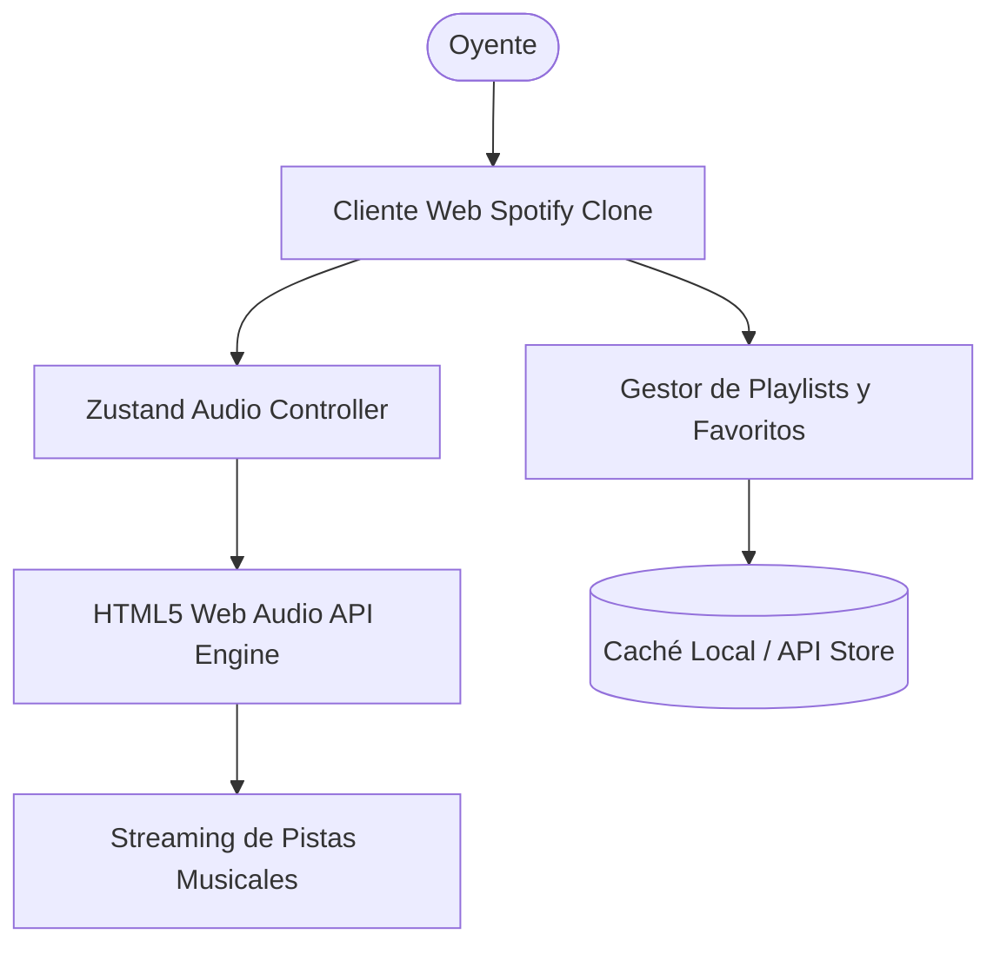
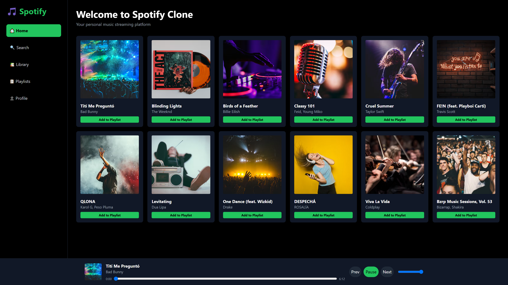
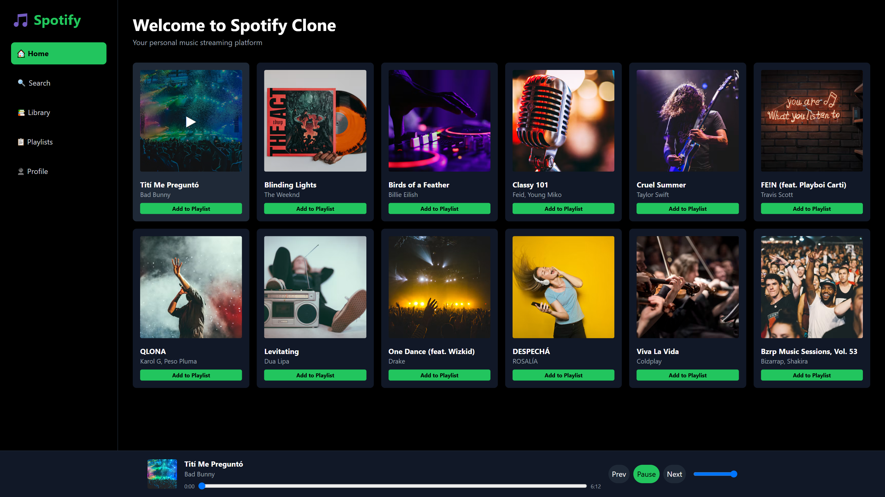
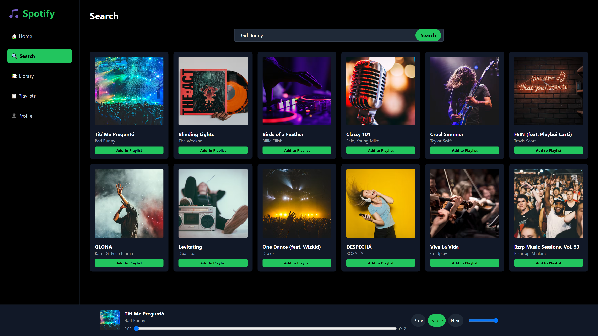
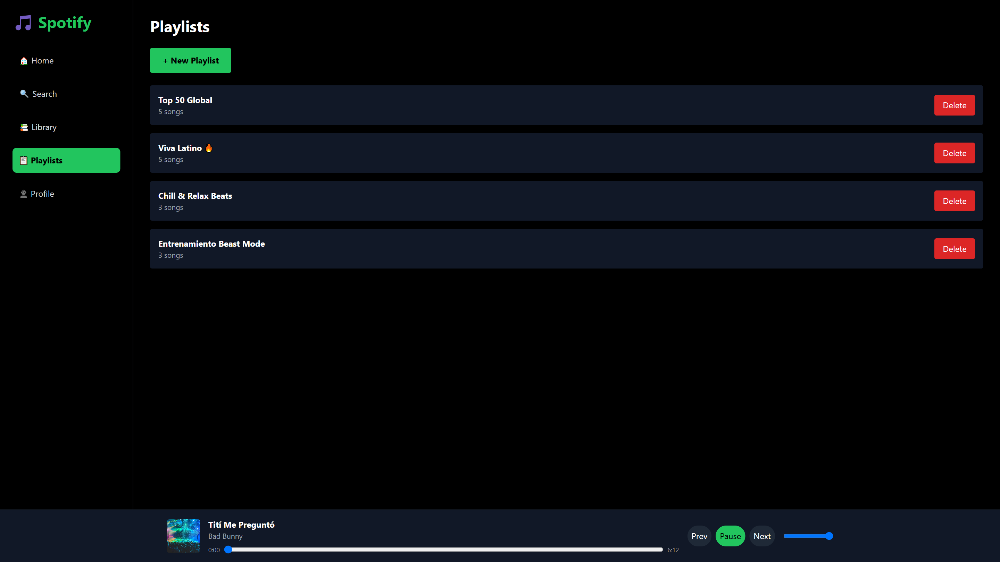
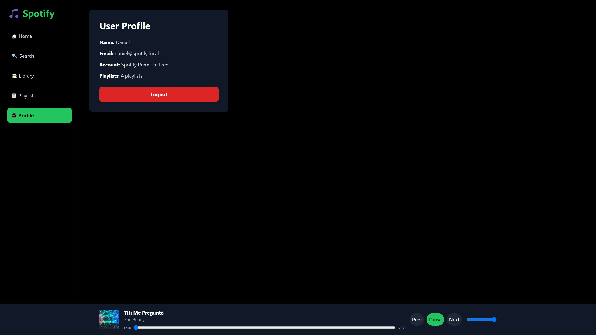

# Spotify Core Platform Clone - Motor de Audio & Streaming Interactivo

### 🏢 Proyecto Desarrollado por **BVX LAB**
*Create. Develop. Grow. // Punta Cana, República Dominicana*

  [_654--8277-25D366?style=for-the-badge&logo=whatsapp&logoColor=white)](https://wa.me/18296548277) 

---

## 📌 Ficha Técnica del Proyecto

| Concepto | Detalle |
| :--- | :--- |
| **Nombre del Proyecto** | **Spotify Core Platform Clone - Motor de Audio & Streaming Interactivo** |
| **Categoría** | Streaming de Audio & Multimedia |
| **Tiempo de Desarrollo** | ⏱️ **2 semanas** |
| **Enlace / URL Oficial** | 🔒 *Arquitectura Demo Multimedia (Privado / Uso Empresarial)* |
| **Empresa Desarrolladora** | [BVX LAB](https://github.com/bvxlabs) |
| **Contacto Directo** | WhatsApp: [+1 (829) 654-8277](https://wa.me/18296548277) · Tel: [+1 (849) 261-6367](tel:18492616367) |

### 🌐 Enlaces y Canales Oficiales
- **Instagram BVX:** [https://www.instagram.com/bvxlaps/](https://www.instagram.com/bvxlaps/)
- **GitHub Autor:** [https://github.com/Wwb-Daniel](https://github.com/Wwb-Daniel)

---

## 📖 Resumen Ejecutivo & Alcance

Implementación completa del cliente web de Spotify con reproducción continua de audio, barra de transporte interactiva con control de volumen, creación y edición de listas de reproducción personalizadas, explorador de pistas musicales y sistema de autenticación de usuarios.

## 🛠️ Stack Tecnológico & Arquitectura

- 🔹 **React**
- 🔹 **TypeScript**
- 🔹 **Web Audio API**
- 🔹 **Tailwind CSS**
- 🔹 **Zustand State Store**
- 🔹 **Node.js Audio Gateway**

## 📊 Métricas & Resultados Clave

| Métrica | Valor |
| :--- | :--- |
| **Transición sin Pausa** | `Audio playback continuo al navegar rutas` |
| **Consistencia de Estado** | `Control global del reproductor en tiempo real` |
| **Diseño** | `100% Dark Liquid Glass Spotify Style` |

---

## 📐 Diagrama de Arquitectura & Flujo de Datos

---

## 📸 Evidencias Visuales & Capturas del Proyecto

### 🖼️ 01-Spotify-Home.png

### 🖼️ 02-Spotify-Reproductor-Activo.png

### 🖼️ 03-Spotify-Search.png

### 🖼️ 04-Spotify-Playlists.png

### 🖼️ 06-Spotify-Profile.png

---

**¿Deseas implementar una solución similar para tu empresa?**  
[Contáctanos directamente vía WhatsApp](https://wa.me/18296548277?text=Hola%20BVX%20LAB,%20me%20interesa%20un%20proyecto%20como%20Spotify%20Core%20Audio%20Player)  

**BVX LAB** · *High-Performance Software, AI & Engineering*

