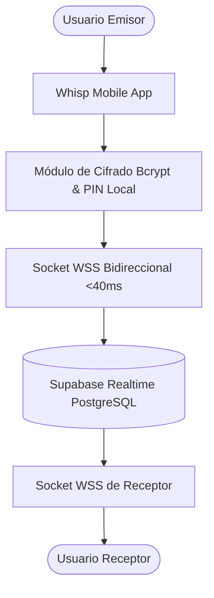
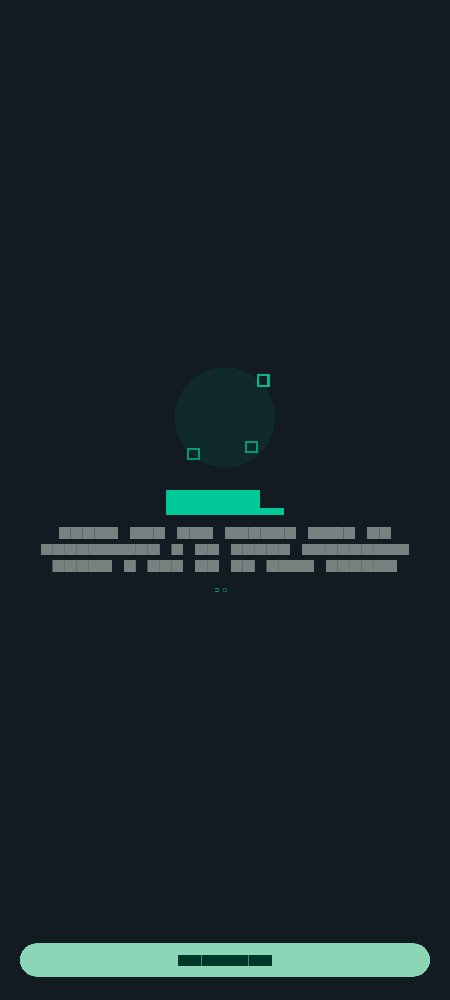
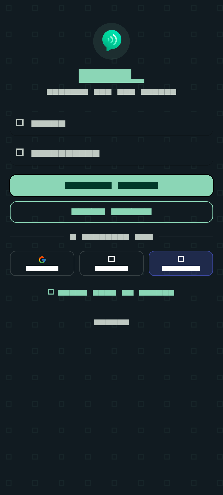
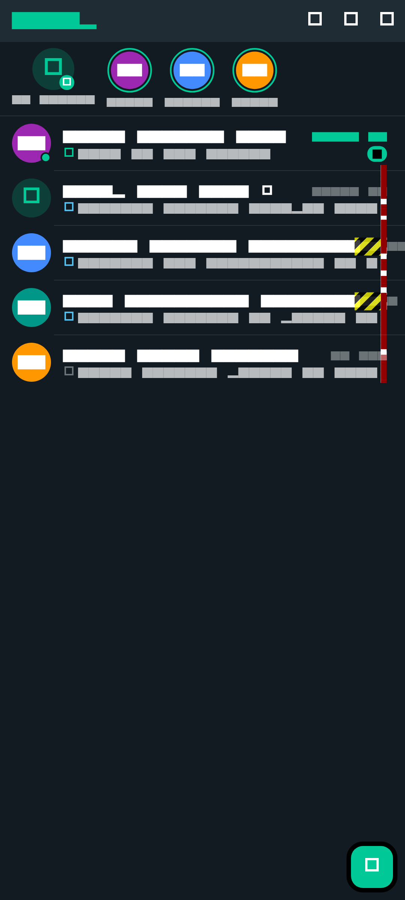
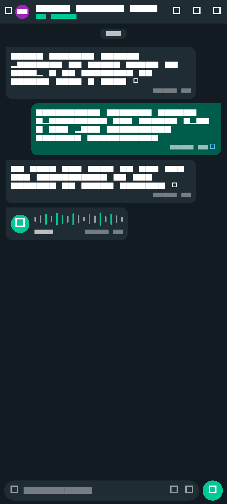
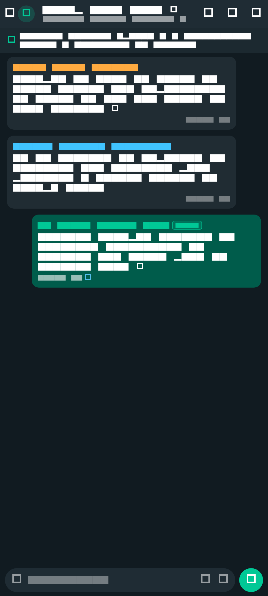
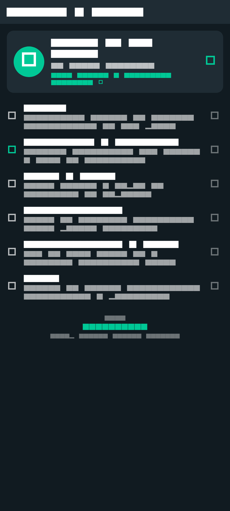

# Whisp: Realtime Messenger - Mensajería Cifrada con WebSockets Sub-40ms

### 🏢 Proyecto Desarrollado por **BVX LAB**
*Create. Develop. Grow. // Punta Cana, República Dominicana*

 [_261--6367-25D366?style=for-the-badge&logo=whatsapp&logoColor=white)](https://wa.me/18492616367) 

---

## 📌 Ficha Técnica del Proyecto

| Concepto | Detalle |
| :--- | :--- |
| **Nombre del Proyecto** | **Whisp: Realtime Messenger - Mensajería Cifrada con WebSockets Sub-40ms** |
| **Categoría** | Telecomunicaciones & Criptografía |
| **Tiempo de Desarrollo** | ⏱️ **6 semanas** |
| **Enlace / URL Oficial** | 🌐 [Repositorio GitHub Oficial](https://github.com/Wwb-Daniel/Whisp) |
| **Empresa Desarrolladora** | [BVX LAB](https://github.com/bvxlabs) |
| **Contacto Directo** | WhatsApp: [+1 (849) 261-6367](https://wa.me/18492616367) |

### 🌐 Enlaces y Canales Oficiales
- **GitHub Repositorio:** [https://github.com/Wwb-Daniel/Whisp](https://github.com/Wwb-Daniel/Whisp)
- **Instagram BVX:** [https://www.instagram.com/bvxlaps/](https://www.instagram.com/bvxlaps/)
- **LinkedIn:** [https://www.linkedin.com/in/victor-dev-291a843a0/](https://www.linkedin.com/in/victor-dev-291a843a0/)
- **Acceso en Vivo:** [https://github.com/Wwb-Daniel/Whisp](https://github.com/Wwb-Daniel/Whisp)

---

## 📖 Resumen Ejecutivo & Alcance

Aplicación nativa de mensajería instantánea de alta seguridad y ultrabaja latencia (<40ms). Conexión bidireccional mediante WebSockets nativos, notas de voz interactivas con espectro de audio, autenticación OTP segura, bloqueo por PIN de acceso offline y sincronización delta con Supabase PostgreSQL.

## 🛠️ Stack Tecnológico & Arquitectura

- 🔹 **Flutter Native**
- 🔹 **WebSockets Sub-40ms Gateway**
- 🔹 **Supabase Realtime Cloud**
- 🔹 **PostgreSQL Row-Level Security**
- 🔹 **Bcrypt Criptografía**
- 🔹 **Audio Waveform Streaming**

## 📊 Métricas & Resultados Clave

| Métrica | Valor |
| :--- | :--- |
| **Latencia de Entrega** | `< 40ms en redes móviles y WiFi` |
| **Privacidad** | `Bloqueo PIN criptográfico local` |
| **Streaming de Audio** | `Notas de voz con codificación comprimida y visualización de onda` |

---

## 📐 Diagrama de Arquitectura & Flujo de Datos

---

## 📸 Evidencias Visuales & Capturas del Proyecto

### 🖼️ 01-onboarding-welcome.png

### 🖼️ 02-login-email-otp.png

### 🖼️ 03-chats-list-overview.png

### 🖼️ 04-chat-room-individual.png

### 🖼️ 05-chat-room-grupo.png

### 🖼️ 06-contactos.png

### 🖼️ 07-ajustes-perfil.png

---

**¿Deseas implementar una solución similar para tu empresa?**  
[Contáctanos directamente vía WhatsApp](https://wa.me/18492616367?text=Hola%20BVX%20LAB,%20me%20interesa%20un%20proyecto%20como%20Whisp%20%2F%2F%20Cifrado%20%26%20WebSockets%20%3C40ms)  

**BVX LAB** · *High-Performance Software, AI & Engineering*

