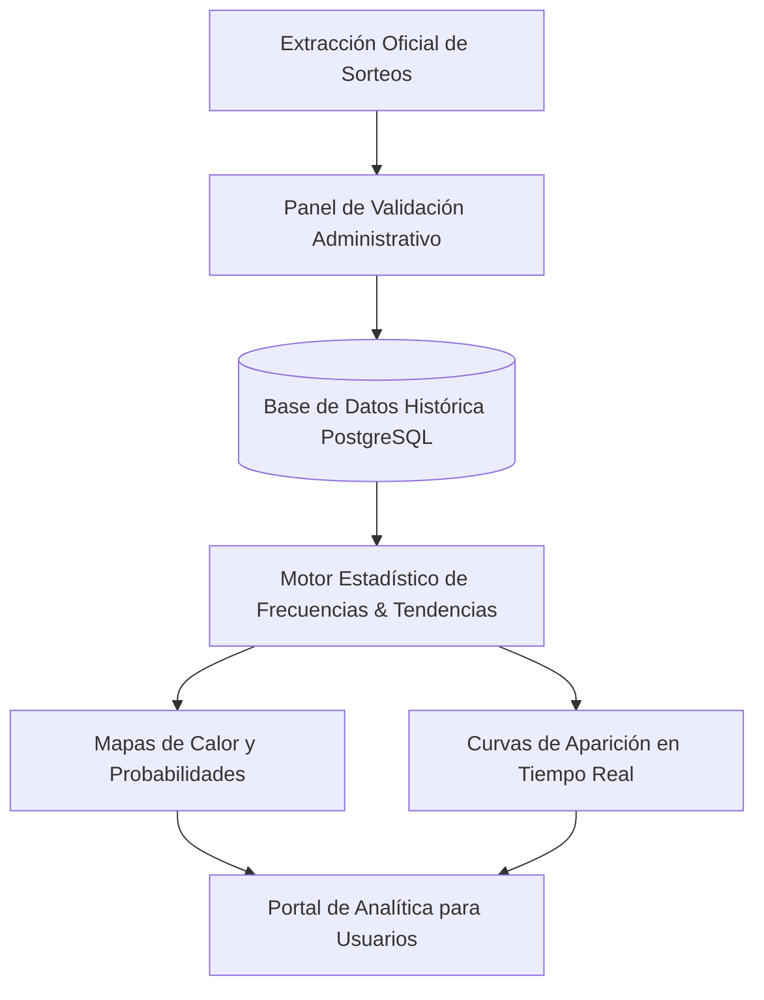
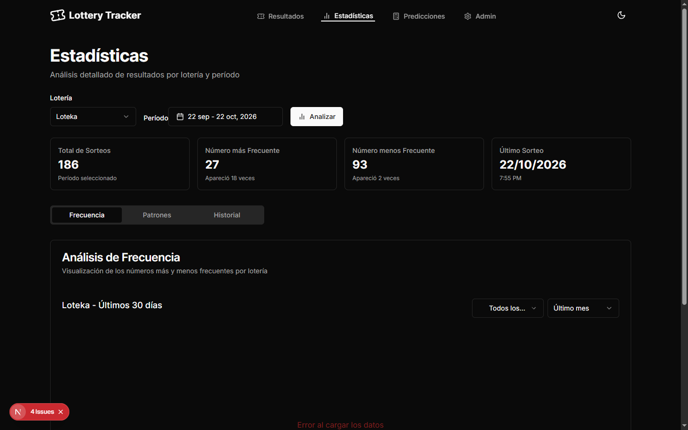
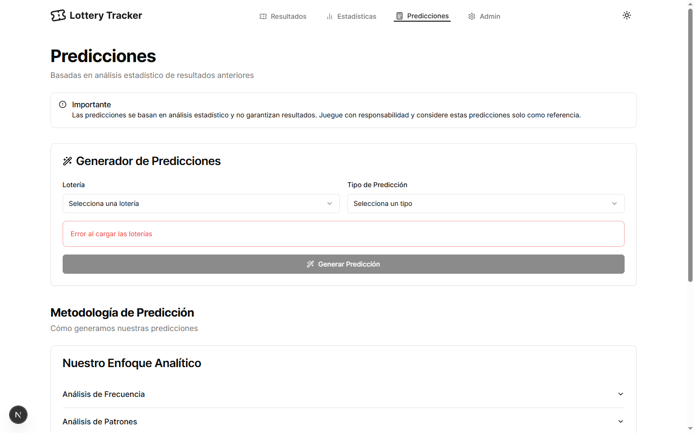
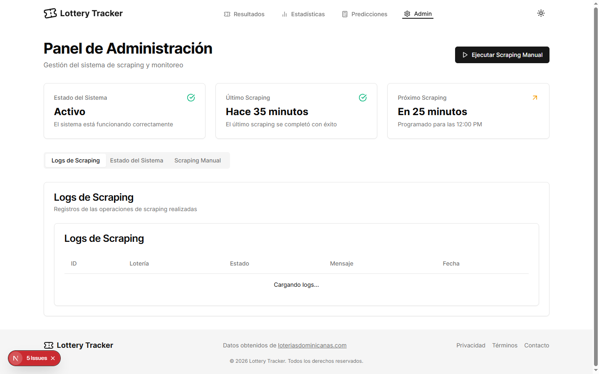

# Lottery Tracker & Analytics - Análisis de Probabilidades, Sorteos & Métricas

### 🏢 Proyecto Desarrollado por **BVX LAB**
*Create. Develop. Grow. // Punta Cana, República Dominicana*

 [_261--6367-25D366?style=for-the-badge&logo=whatsapp&logoColor=white)](https://wa.me/18492616367) 

---

## 📌 Ficha Técnica del Proyecto

| Concepto | Detalle |
| :--- | :--- |
| **Nombre del Proyecto** | **Lottery Tracker & Analytics - Análisis de Probabilidades, Sorteos & Métricas** |
| **Categoría** | Data Analytics & Predicciones |
| **Tiempo de Desarrollo** | ⏱️ **3 semanas** |
| **Enlace / URL Oficial** | 🔒 *Data Analytics Solution BVX (Privado / Uso Empresarial)* |
| **Empresa Desarrolladora** | [BVX LAB](https://github.com/bvxlabs) |
| **Contacto Directo** | WhatsApp: [+1 (849) 261-6367](https://wa.me/18492616367) |

### 🌐 Enlaces y Canales Oficiales
- **Instagram BVX:** [https://www.instagram.com/bvxlaps/](https://www.instagram.com/bvxlaps/)
- **WhatsApp:** [https://wa.me/18492616367](https://wa.me/18492616367)

---

## 📖 Resumen Ejecutivo & Alcance

Plataforma de visualización y análisis estadístico de sorteos de lotería nacionales e internacionales. Algoritmos de cálculo de frecuencias, números calientes/fríos, tendencias históricas en gráficos dinámicos y panel administrativo para registro inmediato de resultados.

## 🛠️ Stack Tecnológico & Arquitectura

- 🔹 **React**
- 🔹 **TypeScript**
- 🔹 **Chart.js / Recharts**
- 🔹 **Tailwind CSS**
- 🔹 **PostgreSQL Database**
- 🔹 **Statistical Prediction Engine**

## 📊 Métricas & Resultados Clave

| Métrica | Valor |
| :--- | :--- |
| **Precisión Analítica** | `100% de trazabilidad histórica de sorteos` |
| **Actualización** | `Resultados en vivo al momento de la extracción` |
| **Visualización** | `Mapas de calor y curvas de distribución normal` |

---

## 📐 Diagrama de Arquitectura & Flujo de Datos

---

## 📸 Evidencias Visuales & Capturas del Proyecto

### 🖼️ 01-lottery-home-database.png

### 🖼️ 02-lottery-stats-database.png

### 🖼️ 03-lottery-predictions.png

### 🖼️ 04-lottery-admin.png

---

**¿Deseas implementar una solución similar para tu empresa?**  
[Contáctanos directamente vía WhatsApp](https://wa.me/18492616367?text=Hola%20BVX%20LAB,%20me%20interesa%20un%20proyecto%20como%20Lottery%20Analytics%20%26%20Trends)  

**BVX LAB** · *High-Performance Software, AI & Engineering*

